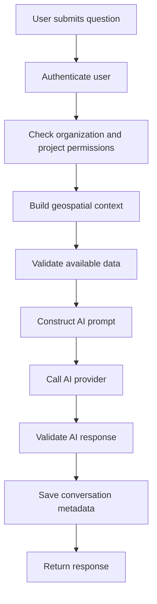

# AI Integration

## 1. Introduction

Artificial Intelligence (AI) is an important component of TERRAMIND.

The platform is designed to integrate AI capabilities with geospatial data, satellite imagery, raster analysis, and environmental monitoring.

The AI assistant should help users understand geographic information and analysis results using natural language.

Potential AI capabilities include:

- Geospatial question answering.
- Satellite imagery analysis assistance.
- NDVI result interpretation.
- Environmental data interpretation.
- Change detection summaries.
- Geographic risk assessment assistance.
- Automated report generation.
- Natural language search.
- Intelligent recommendations.
- Workflow assistance.

This document describes the target AI integration architecture. Actual implementation and provider availability must be verified against the repository.

## 2. AI Integration Architecture

The target architecture separates AI provider communication from application business logic.

```text
backend/app/
├── ai/
│   ├── base.py
│   ├── factory.py
│   ├── openai_provider.py
│   ├── context_builder.py
│   ├── prompts.py
│   ├── ai_analysis_service.py
│   ├── anomaly_detector.py
│   └── guardrails.py
│
├── api/
│   └── v1/
│       └── endpoints/
│           └── ai.py
│
├── schemas/
│   └── ai.py
│
└── services/
    └── report_service.py
```

### Responsibilities

**AI API endpoint**

- Receive AI requests.
- Validate user input.
- Authenticate users.
- Check organization permissions.
- Return AI responses.

**AI provider**

- Communicate with an external AI service.
- Send prompts and context.
- Receive model responses.
- Handle provider errors.

**Context builder**

- Retrieve relevant project information.
- Collect authorized geospatial metadata.
- Prepare analysis results.
- Build structured AI context.

**AI analysis service**

- Coordinate AI analysis.
- Interpret structured analysis results.
- Generate summaries and explanations.
- Validate generated outputs.

**Guardrails**

- Apply input and output restrictions.
- Prevent unauthorized data access.
- Limit available AI operations.
- Validate tool execution requests.

## 3. Supported AI Provider

The initial target integration may use the OpenAI API.

Potential capabilities include:

- Natural language understanding.
- Structured response generation.
- Geospatial result explanations.
- Report summaries.
- Tool calling.
- Conversational assistance.

The AI provider should be configurable so that another provider can be integrated without rewriting application business logic.

Do not assume that an AI model can directly inspect raw satellite pixels accurately without a suitable image-processing or vision workflow.

## 4. AI Provider Abstraction

Create a common interface for AI providers.

Example:

```python
from abc import ABC, abstractmethod


class AIProvider(ABC):

    @abstractmethod
    async def generate_response(
        self,
        prompt: str,
        context: dict
    ) -> str:
        pass
```

This interface allows different AI providers to implement the same application-level operation.

### Provider Factory

Example:

```python
class AIProviderFactory:

    @staticmethod
    def create(provider_name: str):

        if provider_name == "openai":
            from app.ai.openai_provider import OpenAIProvider

            return OpenAIProvider()

        raise ValueError(
            f"Unsupported AI provider: {provider_name}"
        )
```

Provider configuration and API credentials should come from secure application settings.

## 5. OpenAI API Integration

The OpenAI API can be used to generate natural language responses from structured application context.

Install the official Python SDK if it is selected for the project:

```bash
pip install openai
```

Example integration:

```python
from openai import AsyncOpenAI

from app.core.config import settings


class OpenAIProvider:

    def __init__(self):
        self.client = AsyncOpenAI(
            api_key=settings.OPENAI_API_KEY
        )

    async def generate_response(
        self,
        prompt: str,
        context: dict
    ) -> str:

        response = await self.client.responses.create(
            model=settings.OPENAI_MODEL,
            instructions=(
                "You are a geospatial intelligence assistant. "
                "Explain results clearly and do not invent "
                "measurements or analysis findings."
            ),
            input=(
                f"Context: {context}\n\n"
                f"User question: {prompt}"
            )
        )

        return response.output_text
```

This is an illustrative integration. Confirm the installed SDK version, selected model, supported API parameters, and actual project configuration before implementation.

## 6. Environment Configuration

AI credentials must be stored securely.

Example environment variables:

```env
AI_PROVIDER=openai
OPENAI_API_KEY=your-api-key
OPENAI_MODEL=your-selected-model
AI_ENABLED=true
AI_REQUEST_TIMEOUT=60
AI_MAX_OUTPUT_TOKENS=2000
```

Important security rules:

- Never commit API keys to Git.
- Never expose API keys to frontend code.
- Do not use `NEXT_PUBLIC_` for private credentials.
- Use a secrets manager in production.
- Restrict access to AI configuration.
- Rotate credentials when necessary.
- Avoid logging sensitive prompts and responses.

## 7. Geospatial Context Building

AI responses should be based on actual application data.

The context builder should retrieve only information the authenticated user is allowed to access.

Potential context information:

- Organization information.
- Project information.
- Selected geographic area.
- Geographic boundaries.
- Satellite dataset metadata.
- Acquisition dates.
- NDVI statistics.
- Change detection results.
- Environmental monitoring results.
- Previous authorized analysis results.

Example:

```python
def build_geospatial_context(
    project,
    area,
    analysis
):

    return {
        "project": {
            "name": project.name
        },
        "area": {
            "name": area.name
        },
        "analysis": {
            "type": analysis.analysis_type,
            "status": analysis.processing_status,
            "statistics": analysis.statistics
        }
    }
```

The actual model attributes must match the project's SQLAlchemy models.

### Context Requirements

The context builder should:

1. Verify user access.
2. Retrieve the requested project.
3. Retrieve the selected geographic area.
4. Retrieve authorized analysis results.
5. Remove unnecessary personal information.
6. Normalize the data.
7. Build a structured context.
8. Pass the context to the AI provider.

The AI model must never be trusted to enforce application authorization.

## 8. AI Geospatial Assistant

The AI assistant should allow users to ask natural language questions about their projects and geographic analysis.

Example questions:

- What is the average NDVI of this area?
- Explain the vegetation changes between two observations.
- Summarize the latest satellite analysis.
- Which areas show a decrease in vegetation index?
- Explain the available environmental monitoring results.
- Generate a summary of this project.

The assistant should answer using authorized and available data.

If the requested information is unavailable, it should clearly state that it cannot determine the answer.

## 9. AI Analysis Workflow

The target workflow:



## 10. Prompt Management

AI prompts should be maintained separately from API endpoints and business logic.

Example:

```python
GEOSPATIAL_ASSISTANT_PROMPT = """
You are an assistant for a geospatial intelligence platform.

Your responsibilities:
- Explain geographic analysis results.
- Summarize satellite observations.
- Explain vegetation index measurements.
- Provide clear and simple answers.

Rules:
- Use only the supplied context for factual analysis claims.
- Never invent measurements or observations.
- Clearly identify missing information.
- Distinguish measured results from possible explanations.
- Do not claim to have processed satellite imagery
  unless the application provides a verified result.
- Respect user and organization data boundaries.
"""
```

Prompts should be versioned and tested.

Do not rely on prompt instructions as a replacement for backend authorization or validation.

## 11. NDVI Interpretation with AI

AI can explain NDVI results using numerical outputs calculated by the geospatial processing system.

Example context:

```json
{
  "analysis_type": "NDVI",
  "mean_ndvi": 0.62,
  "minimum_ndvi": 0.18,
  "maximum_ndvi": 0.84,
  "valid_pixel_count": 15000,
  "observation_date": "2026-01-15"
}
```

Example user question:

```text
Explain the vegetation condition in this area.
```

The AI assistant can produce a plain-language explanation based on the supplied statistics.

It should mention that NDVI alone cannot establish the complete health or productivity of vegetation.

The AI must not fabricate values or independently claim that the entire selected area has a particular condition based only on a mean value.

## 12. Change Detection Interpretation

AI can summarize results produced by the change detection engine.

Example context:

```json
{
  "analysis_type": "NDVI_CHANGE",
  "old_mean_ndvi": 0.68,
  "new_mean_ndvi": 0.51,
  "difference": -0.17,
  "observation_period": {
    "start": "2025-01-15",
    "end": "2026-01-15"
  }
}
```

Potential AI output:

- Explain the measured difference.
- Identify the direction of change.
- Summarize the comparison period.
- Mention data quality limitations.
- Recommend further investigation where appropriate.

A measured NDVI decrease should not automatically be described as confirmed deforestation or environmental damage.

## 13. AI Tool Calling

The AI assistant may need to request application operations.

Potential tools include:

| Tool | Purpose |
|---|---|
| get_project_details | Retrieve authorized project information |
| get_area_details | Retrieve geographic area metadata |
| search_datasets | Search available datasets |
| get_ndvi_statistics | Retrieve completed NDVI statistics |
| get_change_detection | Retrieve completed change detection results |
| generate_report | Request report generation |

Tool execution must happen through backend-controlled functions.

The AI model may suggest a tool call, but the backend must independently validate:

- Tool availability.
- User permissions.
- Organization membership.
- Project access.
- Input parameters.
- Resource limits.

Never allow an AI-generated tool request to execute arbitrary SQL, shell commands, or unrestricted filesystem operations.

## 14. AI Guardrails

AI integration must include application-level guardrails.

### Input Validation

- Limit prompt length.
- Validate request structures.
- Reject unsupported operations.
- Apply request rate limits.
- Detect potentially sensitive input.

### Output Validation

- Validate structured response formats.
- Reject invalid tool arguments.
- Prevent disclosure of internal data.
- Avoid exposing credentials.
- Identify unsupported factual claims where possible.

### Data Access

- Apply tenant filtering before building context.
- Use authorized repositories.
- Restrict tool permissions.
- Do not allow cross-organization data retrieval.
- Treat external documents and retrieved content as untrusted input.

### Prompt Injection Protection

Retrieved documents, datasets, metadata, and user prompts may contain instructions that attempt to manipulate the AI.

The system should:

- Treat retrieved content as data, not system instructions.
- Separate trusted instructions from untrusted context.
- Limit available tools.
- Validate all tool arguments.
- Require explicit authorization for sensitive actions.

## 15. AI Conversations

The platform may support conversation history.

Potential conversation features:

- Create a conversation.
- Send a message.
- Retrieve previous messages.
- Rename a conversation.
- Delete a conversation.
- Associate conversations with projects.

Suggested metadata:

| Field | Description |
|---|---|
| id | Conversation identifier |
| organization_id | Organization identifier |
| user_id | Conversation owner |
| project_id | Optional project reference |
| title | Conversation title |
| created_at | Creation timestamp |
| updated_at | Last update timestamp |

Message records may include:

- Message ID.
- Conversation ID.
- Role.
- Content.
- Provider/model metadata.
- Creation timestamp.
- Optional token usage information.

Conversation history must follow user permissions and data retention policies.

## 16. AI Report Generation

AI can assist with creating reports from verified analysis results.

Potential report sections:

- Project overview.
- Geographic area description.
- Satellite observation details.
- NDVI analysis summary.
- Change detection summary.
- Environmental monitoring results.
- Data quality limitations.
- Recommendations for further investigation.

The application should provide verified numerical results and metadata to the AI.

AI-generated reports should be reviewed and clearly distinguish measured facts from interpretations.

## 17. Asynchronous AI Processing

Long-running AI operations should be handled using background processing where appropriate.

Potential operations include:

- Large report generation.
- Batch analysis summaries.
- Multiple dataset comparisons.
- Extensive project summaries.

Target workflow:

```text
Frontend
   |
   v
FastAPI
   |
   v
Validate Request
   |
   v
Create AI Job
   |
   v
Redis / Celery
   |
   v
AI Worker
   |
   v
Build Context
   |
   v
Call AI Provider
   |
   v
Validate Response
   |
   v
Save Result
   |
   v
Return Job Status
```

Simple conversational requests may use a normal asynchronous API request if they fit the application's timeout and resource limits.

## 18. API Design

Potential API endpoints:

| Method | Endpoint | Purpose |
|---|---|---|
| POST | `/api/v1/ai/chat` | Send an AI message |
| GET | `/api/v1/ai/conversations` | List conversations |
| POST | `/api/v1/ai/conversations` | Create a conversation |
| GET | `/api/v1/ai/conversations/{id}` | Retrieve a conversation |
| DELETE | `/api/v1/ai/conversations/{id}` | Delete a conversation |
| POST | `/api/v1/ai/analyze` | Request AI-assisted analysis |
| POST | `/api/v1/ai/reports` | Request AI-assisted report generation |

These are proposed endpoints. Verify the actual API implementation before treating them as available.

## 19. Error Handling

The system should handle:

| Error | Recommended handling |
|---|---|
| Missing API key | Disable provider and report configuration error |
| Provider unavailable | Return a controlled service error |
| Rate limit exceeded | Apply backoff and retry where appropriate |
| Request timeout | Record failure and handle safely |
| Invalid response | Reject or retry according to policy |
| Context unavailable | Explain missing application data |
| Unauthorized access | Reject the operation |
| Token limit exceeded | Reduce context or request a smaller response |
| Invalid tool arguments | Reject tool execution |

Do not retry permanent validation or authorization failures.

## 20. Monitoring and Cost Management

AI usage should be monitored.

Track:

- Request count.
- Provider response time.
- Error count.
- Token usage where available.
- Model selection.
- Estimated API cost.
- User and organization usage.
- Rate-limit events.

Recommended controls:

- Per-user request limits.
- Organization-level usage limits.
- Maximum input size.
- Maximum output size.
- Model configuration.
- Timeout configuration.
- Budget alerts.
- Secure logging.

Do not store complete sensitive prompts or responses in application logs unnecessarily.

## 21. Testing

### Unit Tests

Test:

- Provider factory.
- Prompt construction.
- Context building.
- Response parsing.
- Tool argument validation.
- AI guardrails.
- Error handling.

### Integration Tests

Test:

- AI provider connectivity.
- API request handling.
- Conversation persistence.
- Authorized project context.
- Tool execution.
- Usage tracking.

Use mocked AI responses for predictable automated tests.

Live provider tests should be separate and should not be required for every normal CI run.

### Security Tests

Test:

- Cross-organization data access.
- Prompt injection attempts.
- Unauthorized tool execution.
- Credential exposure.
- Oversized prompts.
- Malformed model responses.

## 22. Implementation Verification

Before considering AI integration complete, verify:

- [ ] AI provider abstraction is implemented.
- [ ] Provider configuration works.
- [ ] API credentials are protected.
- [ ] OpenAI integration works, if selected.
- [ ] Context builder retrieves authorized data.
- [ ] Geospatial assistant works.
- [ ] NDVI interpretation uses verified results.
- [ ] Change detection interpretation works.
- [ ] Prompt management is implemented.
- [ ] Tool calling is restricted.
- [ ] Input and output validation works.
- [ ] Prompt injection protections are implemented.
- [ ] Conversation history is persisted securely.
- [ ] AI report generation works.
- [ ] Usage monitoring is available.
- [ ] Rate limiting is enforced.
- [ ] Automated tests pass.

## 23. Important Notes

This document describes the target AI integration architecture for TERRAMIND.

It does not confirm that the AI provider, endpoints, tools, conversation models, or background workers currently exist.

AI should assist with understanding verified geospatial results. Scientific calculations, spatial queries, authorization decisions, and critical business rules must remain controlled by the application.

AI-generated interpretations should not be presented as verified scientific measurements.