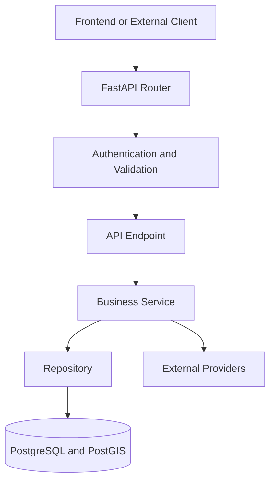

# API Documentation

## 1. Introduction

This document describes the REST API architecture and conventions for TERRAMIND.

The backend is designed with Python and FastAPI. It exposes APIs that allow the frontend and authorized external applications to interact with projects, geographic areas, satellite datasets, geospatial analysis, AI services, and monitoring functionality.

The API is intended to support:

- User authentication and account management.
- Organization and membership management.
- Project and area management.
- Satellite data discovery and capture management.
- Dataset management.
- Geospatial analysis.
- Change detection.
- AI-powered analysis.
- Monitoring and environmental alerts.
- Reports and exports.
- Audit logging.

**Important:** The endpoints and examples in this document describe the target API design. They are not confirmation that every endpoint has been implemented. Verify actual routes, methods, schemas, and permissions against the FastAPI application.

## 2. API Base URL

The local development API is expected to use:

```text
http://localhost:8000
```

The API version prefix is:

```text
/api/v1
```

Example endpoint:

```text
http://localhost:8000/api/v1/projects/
```

The actual base URL may differ between development, staging, and production.

## 3. API Architecture

The API follows a layered architecture.



### Layer responsibilities

| Layer | Responsibility |
|---|---|
| Client | Sends HTTP requests |
| Router | Registers API routes |
| Dependencies | Authentication, permissions, and shared dependencies |
| Endpoint | Handles HTTP request and response processing |
| Service | Implements business logic |
| Repository | Performs database operations |
| Database | Stores persistent application data |
| External providers | Supplies external satellite or AI services |

API endpoints should remain focused on HTTP operations. Business logic should be implemented in service modules where practical.

## 4. API Versioning

The API uses a versioned route prefix.

```text
/api/v1/
```

Versioning helps maintain compatibility as the application evolves.

When introducing breaking changes:

1. Evaluate the impact on existing clients.
2. Plan a new API version where necessary.
3. Document deprecated endpoints.
4. Provide a migration path for clients.
5. Avoid silently changing existing response formats.

## 5. HTTP Methods

The API uses standard HTTP methods.

| Method | Purpose | Example |
|---|---|---|
| `GET` | Retrieve resources | Get project details |
| `POST` | Create a resource or start an operation | Create a project |
| `PUT` | Replace a resource | Replace project configuration |
| `PATCH` | Partially update a resource | Update project name |
| `DELETE` | Delete a resource | Delete a project |

Use the method that matches the operation's behavior.

## 6. Endpoint Organization

The following endpoint groups describe the intended API structure.

### 6.1 Health

Base path:

```text
/api/v1/health
```

Purpose:

- Check application availability.
- Check service readiness.
- Support infrastructure health checks.

Example:

```http
GET /api/v1/health
```

### 6.2 Authentication

Base path:

```text
/api/v1/auth
```

Potential operations:

| Method | Endpoint | Purpose |
|---|---|---|
| POST | `/api/v1/auth/register` | Register an account |
| POST | `/api/v1/auth/login` | Authenticate a user |
| POST | `/api/v1/auth/refresh` | Refresh authentication tokens |
| POST | `/api/v1/auth/logout` | End an authenticated session |
| GET | `/api/v1/auth/me` | Get the current user |

The actual paths and supported operations must match the authentication router.

### 6.3 Users

Base path:

```text
/api/v1/users
```

Potential operations:

| Method | Endpoint | Purpose |
|---|---|---|
| GET | `/api/v1/users/me` | Retrieve current user information |
| PATCH | `/api/v1/users/me` | Update current user information |
| GET | `/api/v1/users/` | List users, if authorized |
| GET | `/api/v1/users/{user_id}` | Retrieve a user, if authorized |

### 6.4 Organizations

Base path:

```text
/api/v1/organizations
```

Potential operations:

| Method | Endpoint | Purpose |
|---|---|---|
| POST | `/api/v1/organizations/` | Create an organization |
| GET | `/api/v1/organizations/` | List accessible organizations |
| GET | `/api/v1/organizations/{organization_id}` | Retrieve organization details |
| PATCH | `/api/v1/organizations/{organization_id}` | Update organization details |
| DELETE | `/api/v1/organizations/{organization_id}` | Delete an organization, if permitted |

### 6.5 Organization Members

Base path:

```text
/api/v1/organization-members
```

Potential operations:

| Method | Endpoint | Purpose |
|---|---|---|
| POST | `/api/v1/organization-members/` | Add a member |
| GET | `/api/v1/organization-members/` | List members |
| PATCH | `/api/v1/organization-members/{member_id}` | Update membership |
| DELETE | `/api/v1/organization-members/{member_id}` | Remove membership |

Membership operations must enforce organization permissions.

### 6.6 Projects

Base path:

```text
/api/v1/projects
```

Potential operations:

| Method | Endpoint | Purpose |
|---|---|---|
| POST | `/api/v1/projects/` | Create a project |
| GET | `/api/v1/projects/` | List accessible projects |
| GET | `/api/v1/projects/{project_id}` | Retrieve project details |
| PATCH | `/api/v1/projects/{project_id}` | Update a project |
| DELETE | `/api/v1/projects/{project_id}` | Delete a project |

### 6.7 Areas

Base path:

```text
/api/v1/areas
```

Potential operations:

| Method | Endpoint | Purpose |
|---|---|---|
| POST | `/api/v1/areas/` | Create a geographic area |
| GET | `/api/v1/areas/` | List accessible areas |
| GET | `/api/v1/areas/{area_id}` | Retrieve area details |
| PATCH | `/api/v1/areas/{area_id}` | Update an area |
| DELETE | `/api/v1/areas/{area_id}` | Delete an area |

Area creation and updates must validate geographic geometry.

### 6.8 Captures

Base path:

```text
/api/v1/captures
```

Potential operations:

| Method | Endpoint | Purpose |
|---|---|---|
| POST | `/api/v1/captures/search` | Search satellite observations |
| POST | `/api/v1/captures/` | Create a capture record or initiate capture processing |
| GET | `/api/v1/captures/` | List captures |
| GET | `/api/v1/captures/{capture_id}` | Retrieve capture details |

The implementation should distinguish between recording an existing observation and initiating a processing job.

### 6.9 Datasets

Base path:

```text
/api/v1/datasets
```

Potential operations:

| Method | Endpoint | Purpose |
|---|---|---|
| GET | `/api/v1/datasets/` | List datasets |
| POST | `/api/v1/datasets/` | Register a dataset |
| GET | `/api/v1/datasets/{dataset_id}` | Retrieve dataset details |
| DELETE | `/api/v1/datasets/{dataset_id}` | Delete a dataset record or managed object |

Deleting a dataset must account for its storage location and related records.

### 6.10 STAC

Base path:

```text
/api/v1/stac
```

Potential operations:

| Method | Endpoint | Purpose |
|---|---|---|
| GET | `/api/v1/stac/collections` | List available collections |
| POST | `/api/v1/stac/search` | Search STAC items |
| GET | `/api/v1/stac/items/{item_id}` | Retrieve an item |

The actual provider integration determines which operations and parameters are supported.

### 6.11 Raster

Base path:

```text
/api/v1/raster
```

Potential operations:

| Method | Endpoint | Purpose |
|---|---|---|
| GET | `/api/v1/raster/{dataset_id}/metadata` | Retrieve raster metadata |
| POST | `/api/v1/raster/{dataset_id}/process` | Submit a raster processing job |
| GET | `/api/v1/raster/{dataset_id}/preview` | Retrieve a preview, if supported |

Long-running raster operations should generally use background jobs.

### 6.12 Analysis

Base path:

```text
/api/v1/analysis
```

Potential operations:

| Method | Endpoint | Purpose |
|---|---|---|
| POST | `/api/v1/analysis/ndvi` | Calculate NDVI |
| POST | `/api/v1/analysis/indices` | Calculate supported indices |
| POST | `/api/v1/analysis/land-cover` | Run land-cover analysis |
| GET | `/api/v1/analysis/{analysis_id}` | Retrieve analysis status or results |

### 6.13 Change Detection

Base path:

```text
/api/v1/change-detection
```

Potential operations:

| Method | Endpoint | Purpose |
|---|---|---|
| POST | `/api/v1/change-detection/` | Submit a change-detection job |
| GET | `/api/v1/change-detection/{job_id}` | Retrieve job status and results |

Change detection requires compatible input datasets and a documented comparison method.

### 6.14 AI

Base path:

```text
/api/v1/ai
```

Potential operations:

| Method | Endpoint | Purpose |
|---|---|---|
| POST | `/api/v1/ai/analyze` | Submit an AI analysis request |
| POST | `/api/v1/ai/summarize` | Summarize analysis results |
| GET | `/api/v1/ai/tasks/{task_id}` | Retrieve task status, if asynchronous |

AI responses should distinguish model-generated interpretation from measured geospatial results.

### 6.15 Agent

Base path:

```text
/api/v1/agent
```

Potential operations:

| Method | Endpoint | Purpose |
|---|---|---|
| POST | `/api/v1/agent/execute` | Submit an agent request |
| GET | `/api/v1/agent/actions/{action_id}` | Retrieve an agent action |
| GET | `/api/v1/agent/actions` | List authorized agent actions |

Agent tools must use the permissions of the requesting user and organization.

### 6.16 Monitoring

Base path:

```text
/api/v1/monitoring
```

Potential operations:

| Method | Endpoint | Purpose |
|---|---|---|
| POST | `/api/v1/monitoring/` | Create a monitoring configuration |
| GET | `/api/v1/monitoring/` | List monitoring configurations |
| GET | `/api/v1/monitoring/{monitoring_id}` | Retrieve monitoring details |
| PATCH | `/api/v1/monitoring/{monitoring_id}` | Update monitoring settings |
| DELETE | `/api/v1/monitoring/{monitoring_id}` | Delete monitoring configuration |

### 6.17 Reports and Exports

Potential base paths:

```text
/api/v1/reports
/api/v1/exports
```

Reports and exports may require background processing for large datasets.

The API should return a task or export identifier when processing is asynchronous.

### 6.18 Audit Logs

Base path:

```text
/api/v1/audit-logs
```

Potential operations:

| Method | Endpoint | Purpose |
|---|---|---|
| GET | `/api/v1/audit-logs/` | List authorized audit events |
| GET | `/api/v1/audit-logs/{audit_log_id}` | Retrieve an audit event |

Access to audit logs should be restricted to authorized users.

## 7. Authentication

Protected endpoints require valid authentication.

The API may use bearer token authentication.

Example request header:

```http
Authorization: Bearer YOUR_ACCESS_TOKEN
```

Example curl request:

```bash
curl -X GET "http://localhost:8000/api/v1/projects/" \
  -H "Authorization: Bearer YOUR_ACCESS_TOKEN"
```

Public endpoints, such as an appropriately configured health endpoint or login endpoint, may not require authentication.

The actual authentication method must match the backend security implementation.

## 8. Request Format

JSON is the standard request format for typical API operations.

Example project creation request:

```http
POST /api/v1/projects/
Content-Type: application/json
```

Example body:

```json
{
  "name": "Colombo Land Monitoring",
  "description": "A project for monitoring selected geographic areas"
}
```

The actual required fields depend on the Pydantic request schema.

## 9. Response Format

A successful request should return an appropriate HTTP status code and a documented response body.

Example project response:

```json
{
  "id": "00000000-0000-0000-0000-000000000001",
  "name": "Colombo Land Monitoring",
  "description": "A project for monitoring selected geographic areas",
  "status": "active",
  "created_at": "2026-11-20T10:00:00Z"
}
```

This is an illustrative response. Actual fields must match the implemented response schema.

## 10. HTTP Status Codes

| Status code | Meaning |
|---|---|
| `200 OK` | Request completed successfully |
| `201 Created` | Resource created successfully |
| `202 Accepted` | Request accepted for asynchronous processing |
| `204 No Content` | Request completed without a response body |
| `400 Bad Request` | Invalid request |
| `401 Unauthorized` | Authentication required or invalid |
| `403 Forbidden` | Insufficient permissions |
| `404 Not Found` | Resource not found |
| `409 Conflict` | Resource conflict |
| `422 Unprocessable Entity` | Request validation failed |
| `429 Too Many Requests` | Rate limit exceeded |
| `500 Internal Server Error` | Unexpected server error |
| `503 Service Unavailable` | Service temporarily unavailable |

Use status codes consistently across API modules.

## 11. Error Response Format

Errors should provide useful information without exposing internal implementation details.

Example:

```json
{
  "detail": "The requested project could not be found."
}
```

For validation failures, FastAPI may return structured validation details.

Example:

```json
{
  "detail": [
    {
      "loc": ["body", "name"],
      "msg": "Field required",
      "type": "missing"
    }
  ]
}
```

Do not expose:

- Database passwords.
- API credentials.
- Access tokens.
- Internal stack traces.
- Sensitive infrastructure details.

## 12. Pagination

List endpoints should support pagination when returning potentially large collections.

A common query format is:

```text
?page=1&page_size=20
```

Example:

```http
GET /api/v1/projects/?page=1&page_size=20
```

An illustrative paginated response:

```json
{
  "items": [],
  "total": 0,
  "page": 1,
  "page_size": 20,
  "total_pages": 0
}
```

The actual pagination format should be consistent across endpoints.

Set a reasonable maximum page size to prevent excessive database queries and response payloads.

## 13. Filtering and Sorting

List endpoints may support filtering and sorting.

Example:

```http
GET /api/v1/projects/?status=active&page=1&page_size=20
```

Example sorting parameter:

```http
GET /api/v1/datasets/?sort_by=created_at&order=desc
```

Only allow supported filter and sort fields.

Validate user-provided values before using them in database queries.

## 14. Geospatial API Requests

Geospatial endpoints may accept GeoJSON geometry.

Example request geometry:

```json
{
  "type": "Polygon",
  "coordinates": [
    [
      [79.8500, 6.9200],
      [79.8700, 6.9200],
      [79.8700, 6.9400],
      [79.8500, 6.9400],
      [79.8500, 6.9200]
    ]
  ]
}
```

GeoJSON coordinates use longitude first and latitude second.

Validate:

- Geometry type.
- Coordinate ranges.
- Geometry validity.
- Coordinate reference system.
- Maximum area or vertex limits where appropriate.

Do not trust geometry supplied by a client without validation.

## 15. Asynchronous Processing

Some operations can take a long time, including:

- Satellite data retrieval.
- Raster processing.
- NDVI calculations.
- Change detection.
- Land-cover classification.
- Large report generation.
- AI workflows.

These operations should generally use background processing rather than blocking the HTTP request.

An asynchronous API may return:

```json
{
  "task_id": "00000000-0000-0000-0000-000000000002",
  "status": "queued"
}
```

The client can then retrieve task status from the corresponding status endpoint.

The actual task identifier and response structure must match the worker implementation.

## 16. Rate Limiting

Rate limits help protect the API from excessive requests.

Consider applying limits to:

- Authentication endpoints.
- AI endpoints.
- Satellite provider searches.
- Export operations.
- Expensive geospatial processing requests.

Rate limits should consider user identity, organization, endpoint, and infrastructure capacity where appropriate.

When a limit is exceeded, return `429 Too Many Requests`.

## 17. Multi-Tenant API Security

Organization-owned resources must be isolated between tenants.

For every protected request:

1. Authenticate the requesting user.
2. Identify the active organization context.
3. Verify organization membership.
4. Check the user's role and permissions.
5. Filter resource queries by organization ownership.
6. Validate parent-child ownership relationships.
7. Record important security events.

Never rely only on a client-provided organization ID to authorize access.

A user must not be able to retrieve another organization's projects by changing an ID in the request.

## 18. API Documentation with FastAPI

FastAPI can generate OpenAPI documentation from registered routes and schemas.

Common local documentation URLs are:

```text
http://localhost:8000/docs
```

```text
http://localhost:8000/redoc
```

OpenAPI JSON is commonly available at:

```text
http://localhost:8000/openapi.json
```

These locations depend on the application's FastAPI configuration. Documentation endpoints may be disabled or restricted in production.

## 19. API Testing

Use automated tests to validate endpoint behavior.

Recommended test areas:

- Successful requests.
- Invalid request payloads.
- Missing authentication.
- Invalid authentication.
- Permission checks.
- Cross-tenant access attempts.
- Missing resources.
- Database failures.
- External provider failures.
- Background task status.
- Rate limiting.

Example request using curl:

```bash
curl -X GET "http://localhost:8000/api/v1/health"
```

Example authenticated request:

```bash
curl -X GET "http://localhost:8000/api/v1/projects/" \
  -H "Authorization: Bearer YOUR_ACCESS_TOKEN"
```

Run backend tests using the configured test runner. If pytest is configured:

```bash
cd backend
pytest
```

## 20. API Development Guidelines

1. Use consistent endpoint naming.
2. Use Pydantic schemas for request and response validation.
3. Keep business logic in service modules.
4. Use repositories for database operations where appropriate.
5. Apply authentication and authorization to protected routes.
6. Validate all user input.
7. Use appropriate HTTP status codes.
8. Keep error responses predictable.
9. Paginate large collections.
10. Use background workers for long-running operations.
11. Record important security events.
12. Add automated tests for new endpoints.
13. Update OpenAPI descriptions and this document when routes change.

## 21. Implementation Verification

Before treating this document as the actual API reference:

1. Inspect `backend/app/api/v1/endpoints/`.
2. Inspect router registration and API prefixes.
3. Review Pydantic request and response schemas.
4. Verify HTTP methods and route paths.
5. Verify authentication and permission dependencies.
6. Check actual response formats and status codes.
7. Test endpoints using the running application.
8. Update this document to match the implemented API.

The registered FastAPI routes and OpenAPI schema are the implementation sources of truth.

---

**Document:** API Documentation  
**Project:** TERRAMIND  
**Status:** Target API reference / requires implementation verification