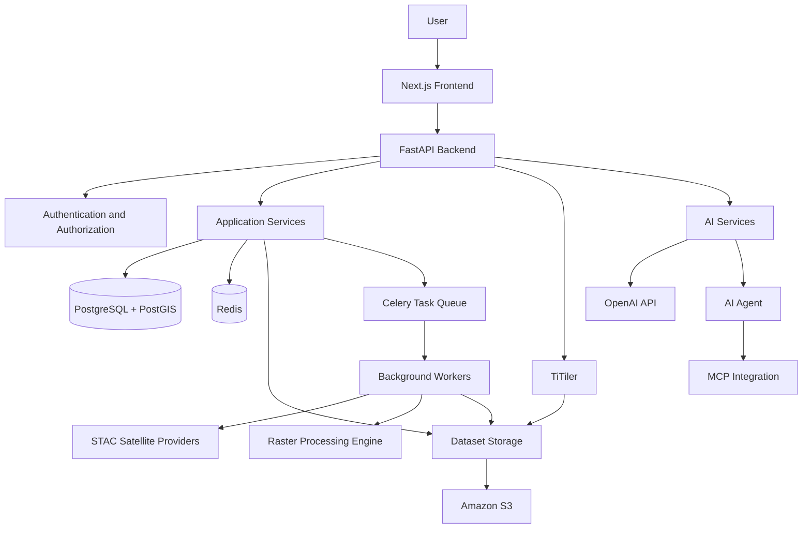
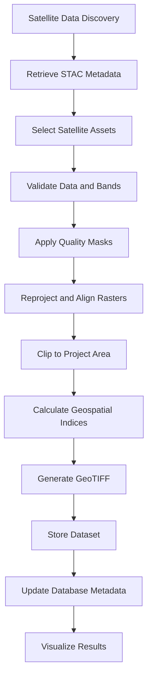
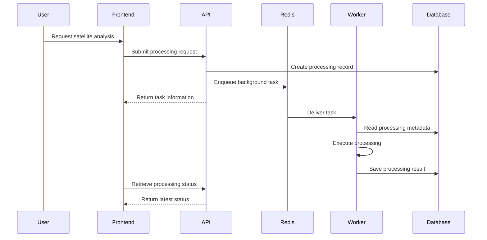
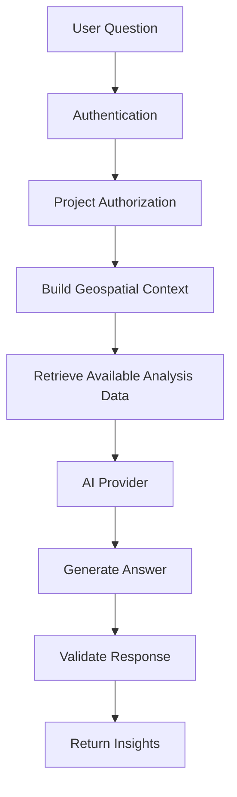

# TERRAMIND — System Architecture

## 1. Introduction

TERRAMIND is a geospatial intelligence platform designed to discover, process, analyze, visualize, and interpret geospatial and satellite imagery data.

The system follows a modular architecture that separates the frontend application, backend APIs, geospatial processing engine, background workers, AI services, database, and cloud infrastructure.

The architecture is designed to support:

- Geospatial project management.
- Interactive map visualization.
- Satellite imagery discovery and ingestion.
- Raster processing and vegetation analysis.
- Environmental monitoring and change detection.
- AI-powered geospatial analysis.
- Automated background processing.
- Multi-organization access control.
- Scalable cloud deployment.

This document describes the target architecture. Implementation details must be validated against the actual source code and deployment configuration.

## 2. Architectural Overview

TERRAMIND consists of the following major layers:

1. Presentation Layer
2. API and Application Layer
3. Business Logic Layer
4. Geospatial Processing Layer
5. AI and Automation Layer
6. Data Storage Layer
7. Infrastructure Layer

### High-Level Architecture



## 3. Frontend Architecture

The frontend is responsible for providing an interactive user interface.

**Technology stack:**

- Next.js
- React
- TypeScript
- Tailwind CSS
- MapLibre GL JS
- TanStack Query
- Zustand
- Axios

### Main Responsibilities

- User authentication and session handling.
- Dashboard and project management.
- Organization management.
- Interactive map visualization.
- Geographic area creation and editing.
- Satellite capture management.
- Raster layer visualization.
- Time-series charts and change detection.
- AI assistant interactions.
- Environmental monitoring.
- Reports and data exports.

### Frontend Communication

The frontend communicates with the backend through REST APIs.

Axios is used for HTTP requests, while TanStack Query manages server-state fetching, caching, and synchronization.

Zustand is used for client-side application state where appropriate.

MapLibre GL JS provides interactive map rendering and raster/vector layer visualization.

## 4. Backend Architecture

The backend is responsible for application business logic, authentication, data access, processing coordination, and integrations.

**Technology stack:**

- Python
- FastAPI
- SQLAlchemy
- Pydantic
- Alembic
- PostgreSQL
- Redis
- Celery

### Backend Responsibilities

- REST API development.
- Authentication and authorization.
- User and organization management.
- Project and area management.
- Satellite data discovery.
- Capture and dataset management.
- Background job dispatch.
- Raster processing coordination.
- AI service integration.
- Environmental monitoring.
- Report and export generation.
- Audit logging.

### Backend Layer Organization

The backend separates responsibilities into the following modules:

| Module | Responsibility |
|---|---|
| API | HTTP endpoints and request handling |
| Core | Application configuration and shared utilities |
| Models | Database entities |
| Schemas | Request and response validation |
| Repositories | Database operations |
| Services | Business logic |
| Security | Authentication and permissions |
| Providers | External data source integrations |
| Geospatial | Spatial and raster algorithms |
| Storage | Dataset storage management |
| Workers | Asynchronous processing |
| AI | AI providers and agents |
| MCP | External tool integration |
| Monitoring | Environmental monitoring and alerts |

## 5. Database Architecture

PostgreSQL with PostGIS is the primary relational and spatial database.

### PostgreSQL Responsibilities

- Store user information.
- Store organizations and memberships.
- Manage projects and geographical areas.
- Store capture metadata.
- Store satellite data references.
- Manage dataset metadata.
- Store analysis results.
- Maintain monitoring configurations.
- Store alerts and audit records.

### PostGIS Responsibilities

PostGIS extends PostgreSQL with spatial data types and operations.

It supports:

- Polygon and multipolygon storage.
- Geometry validation.
- Spatial intersection queries.
- Spatial filtering.
- Coordinate transformations.
- Spatial indexing.
- Geographic measurements.

### Database Access

SQLAlchemy provides ORM functionality.

Alembic manages database schema migrations.

GIST indexes are used for spatial columns where appropriate.

## 6. Satellite Data Architecture

TERRAMIND uses satellite data providers and STAC APIs to discover imagery.

### Target Data Sources

| Provider or dataset | Purpose |
|---|---|
| Earth Search | STAC discovery |
| Sentinel-2 | Optical satellite imagery |
| Sentinel-1 | Synthetic Aperture Radar imagery |
| Landsat | Optical satellite imagery |
| Microsoft Planetary Computer | Additional STAC data access |

### STAC Integration

The STAC workflow is designed to:

1. Receive a project and geographical area.
2. Retrieve the area's geographic boundary.
3. Accept a date range and imagery filters.
4. Search the selected STAC catalog.
5. Retrieve matching satellite items.
6. Extract asset information.
7. Store relevant metadata.
8. Submit selected processing jobs.

Satellite provider integrations should use consistent interfaces while preserving sensor-specific metadata and processing requirements.

## 7. Geospatial Processing Architecture

The geospatial processing engine handles spatial data and satellite imagery.

### Main Technologies

- Rasterio
- NumPy
- Shapely
- GeoAlchemy2
- PyProj
- TiTiler

### Processing Responsibilities

- Geometry validation.
- Coordinate transformations.
- Raster loading.
- Band selection.
- Reflectance scaling.
- Cloud and quality masking.
- Raster reprojection.
- Raster clipping.
- Vegetation index calculation.
- Change detection.
- Land-cover classification.
- Spatial statistics.

### Raster Processing Workflow



All processing operations should preserve CRS information, nodata values, acquisition dates, sensor metadata, and processing parameters.

## 8. Background Processing Architecture

Celery and Redis are used for asynchronous processing.

### Redis Responsibilities

- Celery task broker.
- Task result backend, if configured.
- Application caching.
- Temporary coordination data.

### Celery Responsibilities

- Satellite capture processing.
- Raster processing.
- Vegetation index calculation.
- Change detection.
- Land-cover classification.
- Forecasting.
- Report generation.
- Environmental monitoring.

### Background Task Workflow



Tasks should be idempotent where practical, track their processing state, and handle retries and failures safely.

## 9. Raster Visualization Architecture

TiTiler provides dynamic raster tile generation.

### Visualization Workflow

1. A user selects a processed raster dataset.
2. The frontend requests raster tiles.
3. The backend validates dataset ownership and access.
4. TiTiler reads the corresponding raster.
5. TiTiler generates map tiles.
6. MapLibre displays the raster layer.

Raster storage paths and access permissions must be resolved by the backend. The browser must not receive unrestricted access to internal storage or TiTiler services.

## 10. AI Architecture

AI services provide natural-language access to supported geospatial analysis results.

### Main Components

- AI provider interface.
- OpenAI integration.
- Context builder.
- Prompt management.
- AI analysis service.
- Anomaly detection.
- AI agent.
- Agent tools.
- Guardrails.

### AI Workflow



AI responses should be grounded in available project data.

The AI system must not invent measurements, claim unsupported environmental conclusions, or access data belonging to another organization.

## 11. Model Context Protocol Architecture

The MCP integration exposes selected TERRAMIND capabilities as tools, resources, and prompts.

### Main Responsibilities

- Provide structured geospatial tools.
- Retrieve NDVI time-series data.
- Submit supported analysis questions.
- Generate environmental reports.
- Expose application capabilities.

MCP clients authenticate using an authorized application identity or user token.

Tool execution must enforce the same authorization and tenant-isolation rules as the REST API.

## 12. Monitoring and Automation Architecture

The monitoring system provides scheduled environmental analysis.

### Main Responsibilities

- Create monitoring configurations.
- Schedule analysis jobs.
- Retrieve completed datasets.
- Compare historical observations.
- Evaluate configured thresholds.
- Generate environmental alerts.
- Track alert status.
- Maintain monitoring history.

Monitoring alerts indicate potential changes and should not be treated as definitive environmental conclusions without supporting evidence.

## 13. Multi-Tenant Architecture

TERRAMIND is designed to support multiple organizations.

### Tenant Hierarchy

```text
Organization
    |
    ├── Organization Members
    |
    ├── Projects
    |    |
    |    ├── Areas
    |    ├── Captures
    |    ├── Datasets
    |    └── Analysis Results
    |
    ├── Monitoring Configurations
    |
    └── Audit Logs
```

### Access Control

The target access model includes:

- Organization owners.
- Organization administrators.
- Analysts.
- Viewers.
- Other explicitly defined member roles.

All organization-owned data must be protected through authorization checks and tenant-scoped database access.

PostgreSQL Row-Level Security may provide an additional layer of protection.

## 14. Storage Architecture

TERRAMIND supports local development storage and cloud-based dataset storage.

### Local Development

Local storage is used for development and testing.

### Production Storage

Amazon S3 is the target object-storage service for production datasets.

### Storage Responsibilities

- Original satellite assets, where permitted.
- Processed raster files.
- GeoTIFF datasets.
- Generated exports.
- Environmental reports.
- Temporary processing outputs.

Large raster files should not be stored directly inside PostgreSQL. The database stores their metadata and storage references.

## 15. AWS Deployment Architecture

The production deployment target uses AWS managed and container services.

| AWS Service | Responsibility |
|---|---|
| ECS | Run application containers |
| ECR | Store container images |
| RDS | Managed PostgreSQL database |
| ElastiCache | Managed Redis-compatible caching |
| S3 | Raster and export storage |
| ALB | Application traffic routing |
| Route 53 | DNS management |
| ACM | TLS certificates |
| CloudWatch | Logs and monitoring |
| Secrets Manager | Secure application secrets |

The frontend and API can run on separate ECS services. Background workers should be deployed independently so their compute capacity can scale according to processing workloads.

## 16. Security Architecture

Security is applied across all application layers.

### Main Security Controls

- JWT-based authentication.
- Password hashing.
- Refresh-token rotation.
- Organization membership validation.
- Role-based authorization.
- Tenant-scoped database queries.
- Optional PostgreSQL RLS.
- API rate limiting.
- Secure HTTP headers.
- Private object storage.
- Short-lived download links.
- Input validation.
- Audit logging.
- Background-task authorization.
- Secure secret management.

## 17. Scalability and Reliability

The architecture separates interactive API workloads from compute-intensive geospatial processing.

Scalability strategies include:

- Independent frontend and backend services.
- Independent Celery workers.
- Workload-specific task queues.
- Horizontal worker scaling.
- Database connection pooling.
- Redis caching.
- Object storage for large files.
- Spatial indexes.
- Background processing.
- Structured logging and monitoring.

Reliability strategies include:

- Task retries.
- Idempotent processing.
- Processing status tracking.
- Database backups.
- Object versioning.
- Health checks.
- Error handling.
- Operational monitoring.

## 18. Architectural Principles

TERRAMIND follows these architectural principles:

1. **Modularity:** Separate application responsibilities into maintainable components.
2. **Separation of concerns:** Keep API, business logic, data access, and processing responsibilities distinct.
3. **Security by design:** Apply authentication and authorization throughout the system.
4. **Spatial accuracy:** Preserve geospatial metadata and processing quality.
5. **Scalability:** Separate background processing from interactive requests.
6. **Reliability:** Track processing states and handle failures safely.
7. **Extensibility:** Support additional satellite providers and geospatial algorithms.
8. **Observability:** Make system operations measurable and traceable.

## 19. Implementation Status

This document describes the intended system architecture.

Individual components may be implemented, partially implemented, or planned. Refer to the source code, deployment configuration, tests, and project implementation status report before treating any capability as completed.

---

**Project:** TERRAMIND  
**Document:** System Architecture  
**Path:** `docs/architecture.md`  
**Format:** Markdown
