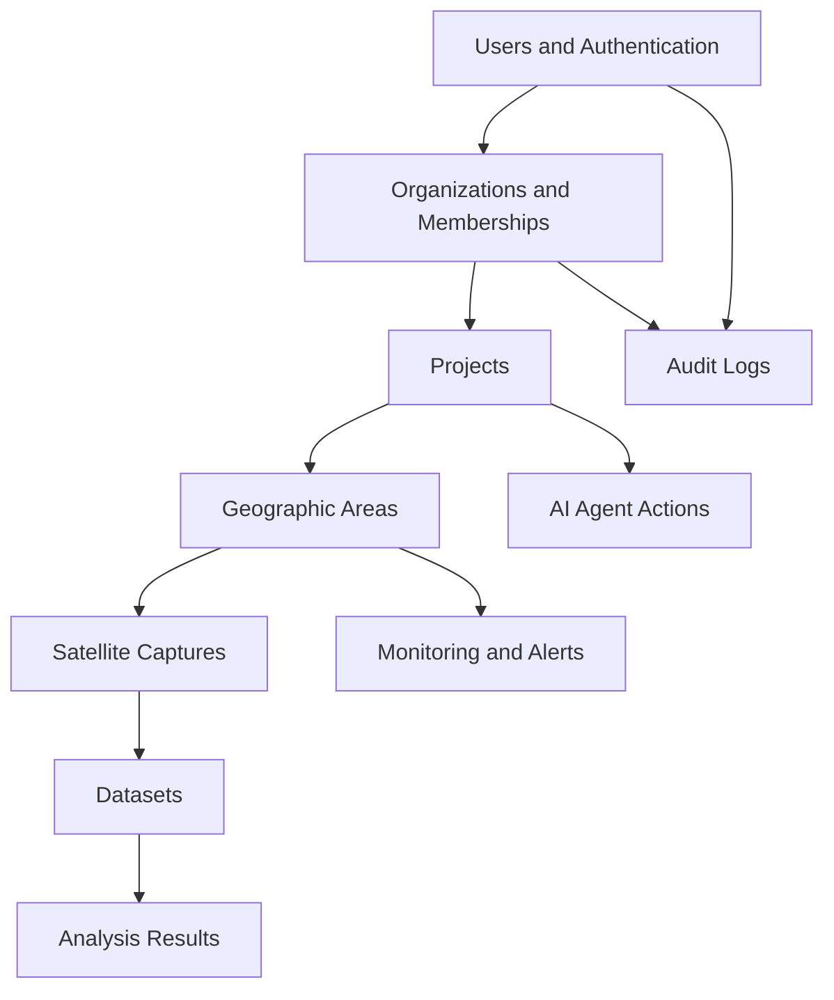

# Database Schema

## 1. Introduction

This document describes the planned database structure for TERRAMIND.

TERRAMIND uses PostgreSQL as its primary relational database and PostGIS for storing and querying geographic information.

The database is intended to support:

- User accounts and authentication.
- Organizations and multi-tenant access.
- Projects and geographic areas.
- Satellite captures and datasets.
- Geospatial analysis results.
- AI agent activities.
- Environmental monitoring and alerts.
- Audit logs and reporting.

**Important:** This is a target database design. Actual tables, columns, constraints, indexes, and relationships must be verified against the SQLAlchemy models and Alembic migrations.

## 2. Database Technologies

| Technology | Purpose |
|---|---|
| PostgreSQL | Primary relational database |
| PostGIS | Geographic data storage and spatial queries |
| SQLAlchemy | Python ORM |
| Alembic | Database migrations |
| Redis | Cache and temporary processing data |

Redis is not a replacement for PostgreSQL. Persistent business records and spatial data belong in the primary database.

## 3. Database Architecture

The planned database is organized into functional groups.



This diagram represents logical relationships, not a verified database diagram.

## 4. Database Extensions

PostGIS must be enabled to support spatial operations.

Example SQL:

```sql
CREATE EXTENSION IF NOT EXISTS postgis;
```

Check the installed PostGIS version:

```sql
SELECT PostGIS_Full_Version();
```

Check PostgreSQL:

```sql
SELECT version();
```

The database deployment must use a PostgreSQL and PostGIS combination supported by the application.

## 5. Core Tables

### 5.1 Users

Table: `users`

Stores application user accounts.

| Column | Suggested type | Description |
|---|---|---|
| `id` | UUID | Primary key |
| `email` | VARCHAR | User email address |
| `hashed_password` | VARCHAR | Password hash |
| `full_name` | VARCHAR | User's display name |
| `is_active` | BOOLEAN | Account status |
| `is_superuser` | BOOLEAN | Administrative privilege |
| `created_at` | TIMESTAMP | Creation timestamp |
| `updated_at` | TIMESTAMP | Last update timestamp |

Email addresses should have an appropriate uniqueness constraint.

Passwords must be stored as secure password hashes, never as plaintext.

### 5.2 Authentication Sessions

Table: `auth_sessions`

Stores authentication session information when session persistence is implemented.

| Column | Suggested type | Description |
|---|---|---|
| `id` | UUID | Primary key |
| `user_id` | UUID | Associated user |
| `token_hash` | VARCHAR | Hashed session token or identifier |
| `expires_at` | TIMESTAMP | Expiration time |
| `revoked_at` | TIMESTAMP | Revocation time |
| `created_at` | TIMESTAMP | Creation time |

Session records should reference users through a foreign key.

Avoid storing raw authentication tokens.

### 5.3 Organizations

Table: `organizations`

Stores tenant or organization information.

| Column | Suggested type | Description |
|---|---|---|
| `id` | UUID | Primary key |
| `name` | VARCHAR | Organization name |
| `slug` | VARCHAR | Unique organization identifier |
| `description` | TEXT | Organization description |
| `is_active` | BOOLEAN | Organization status |
| `created_at` | TIMESTAMP | Creation timestamp |
| `updated_at` | TIMESTAMP | Last update timestamp |

An organization represents a tenant boundary for organization-owned resources.

### 5.4 Organization Members

Table: `organization_members`

Connects users to organizations.

| Column | Suggested type | Description |
|---|---|---|
| `id` | UUID | Primary key |
| `organization_id` | UUID | Organization reference |
| `user_id` | UUID | User reference |
| `role` | VARCHAR | Organization role |
| `is_active` | BOOLEAN | Membership status |
| `created_at` | TIMESTAMP | Creation timestamp |

Recommended logical constraint:

```text
UNIQUE (organization_id, user_id)
```

Possible organization roles include:

- Owner
- Admin
- Member
- Viewer

The role names and permissions must be consistent with the authorization implementation.

## 6. Project Tables

### 6.1 Projects

Table: `projects`

Stores geospatial projects.

| Column | Suggested type | Description |
|---|---|---|
| `id` | UUID | Primary key |
| `organization_id` | UUID | Owning organization |
| `name` | VARCHAR | Project name |
| `description` | TEXT | Project description |
| `status` | VARCHAR | Project status |
| `created_by` | UUID | Creating user |
| `created_at` | TIMESTAMP | Creation timestamp |
| `updated_at` | TIMESTAMP | Last update timestamp |

A project should belong to an organization.

### 6.2 Areas

Table: `areas`

Stores geographic areas associated with projects.

| Column | Suggested type | Description |
|---|---|---|
| `id` | UUID | Primary key |
| `project_id` | UUID | Associated project |
| `name` | VARCHAR | Area name |
| `description` | TEXT | Area description |
| `geometry` | GEOMETRY | Geographic boundary |
| `area_sq_km` | DOUBLE PRECISION | Calculated area |
| `created_at` | TIMESTAMP | Creation timestamp |
| `updated_at` | TIMESTAMP | Last update timestamp |

The geometry column may use a spatial type such as:

```sql
geometry(MultiPolygon, 4326)
```

The exact geometry type and coordinate reference system must match the application's spatial requirements.

## 7. Satellite Data Tables

### 7.1 Captures

Table: `captures`

Stores satellite acquisition or observation metadata.

| Column | Suggested type | Description |
|---|---|---|
| `id` | UUID | Primary key |
| `area_id` | UUID | Associated geographic area |
| `provider` | VARCHAR | Satellite data provider |
| `collection_id` | VARCHAR | STAC collection identifier |
| `item_id` | VARCHAR | STAC item identifier |
| `acquired_at` | TIMESTAMP | Acquisition time |
| `cloud_cover` | DOUBLE PRECISION | Cloud cover percentage |
| `metadata` | JSONB | Additional provider metadata |
| `created_at` | TIMESTAMP | Record creation time |

A capture should retain enough metadata to identify and retrieve the original satellite observation.

### 7.2 Datasets

Table: `datasets`

Stores information about raster and other geospatial datasets.

| Column | Suggested type | Description |
|---|---|---|
| `id` | UUID | Primary key |
| `capture_id` | UUID | Associated capture, if applicable |
| `organization_id` | UUID | Owning organization |
| `name` | VARCHAR | Dataset name |
| `dataset_type` | VARCHAR | Dataset category |
| `storage_uri` | TEXT | Dataset storage location |
| `file_format` | VARCHAR | File format |
| `crs` | VARCHAR | Coordinate reference system |
| `metadata` | JSONB | Additional metadata |
| `created_at` | TIMESTAMP | Creation timestamp |

Large raster files should generally be stored in object storage rather than directly inside PostgreSQL.

The database should store metadata and references to those files.

## 8. Geospatial Analysis Tables

Analysis results may include vegetation indices, water indices, land-cover classifications, and change-detection results.

A proposed logical analysis record could contain:

| Column | Suggested type | Description |
|---|---|---|
| `id` | UUID | Primary key |
| `dataset_id` | UUID | Input dataset |
| `organization_id` | UUID | Owning organization |
| `analysis_type` | VARCHAR | Analysis category |
| `status` | VARCHAR | Processing status |
| `parameters` | JSONB | Processing parameters |
| `result_uri` | TEXT | Output storage location |
| `statistics` | JSONB | Calculated statistics |
| `created_at` | TIMESTAMP | Creation timestamp |
| `completed_at` | TIMESTAMP | Completion timestamp |

This is a proposed logical structure. A separate analysis model may be required for individual analysis types.

## 9. AI Agent Tables

### 9.1 Agent Actions

Table: `agent_actions`

Stores AI agent execution records.

| Column | Suggested type | Description |
|---|---|---|
| `id` | UUID | Primary key |
| `organization_id` | UUID | Organization context |
| `user_id` | UUID | Requesting user |
| `action_type` | VARCHAR | Agent action type |
| `status` | VARCHAR | Execution status |
| `input_summary` | TEXT | Input summary |
| `result_summary` | TEXT | Result summary |
| `created_at` | TIMESTAMP | Creation timestamp |
| `completed_at` | TIMESTAMP | Completion timestamp |

Do not store API secrets, access tokens, or unnecessary sensitive prompt content in agent records.

## 10. Monitoring and Environmental Alerts

### 10.1 Monitoring Records

Stores monitoring configurations and results.

Possible fields include:

- Organization reference.
- Project reference.
- Area reference.
- Monitoring type.
- Monitoring frequency.
- Last execution time.
- Next scheduled execution time.
- Monitoring status.

### 10.2 Environmental Alerts

Stores alerts generated from monitoring or analysis.

Possible fields include:

- Organization reference.
- Area reference.
- Alert type.
- Severity.
- Description.
- Detection timestamp.
- Status.
- Related analysis reference.

These structures should be finalized based on actual monitoring requirements.

## 11. Audit Logs

Table: `audit_logs`

Records important application and security events.

| Column | Suggested type | Description |
|---|---|---|
| `id` | UUID | Primary key |
| `organization_id` | UUID | Organization context, if applicable |
| `user_id` | UUID | Actor |
| `action` | VARCHAR | Action performed |
| `resource_type` | VARCHAR | Resource category |
| `resource_id` | UUID | Affected resource |
| `ip_address` | INET | Request IP address, where appropriate |
| `metadata` | JSONB | Additional event metadata |
| `created_at` | TIMESTAMP | Event timestamp |

Audit records should be protected from unauthorized modification.

Avoid recording passwords, tokens, or other secrets.

## 12. Entity Relationships

The following relationships describe the intended logical data model.

| Parent | Child | Relationship |
|---|---|---|
| Users | Authentication Sessions | One-to-many |
| Users | Organization Members | One-to-many |
| Organizations | Organization Members | One-to-many |
| Organizations | Projects | One-to-many |
| Projects | Areas | One-to-many |
| Areas | Captures | One-to-many |
| Captures | Datasets | One-to-many or project-specific design |
| Datasets | Analysis Results | One-to-many |
| Users | Agent Actions | One-to-many |
| Organizations | Agent Actions | One-to-many |
| Users | Audit Logs | One-to-many |

The final foreign keys and deletion behavior must be defined in the SQLAlchemy models.

## 13. Spatial Data and Coordinate Systems

PostGIS supports geographic and projected spatial data.

Common spatial types include:

- `POINT`
- `LINESTRING`
- `POLYGON`
- `MULTIPOLYGON`
- `GEOMETRY`

A geographic area may use:

```sql
geometry(MultiPolygon, 4326)
```

EPSG:4326 represents geographic coordinates using longitude and latitude.

Spatial calculations such as area and distance should use an appropriate projected coordinate system or geography operations where required.

Do not assume that calculating area directly from longitude and latitude coordinates produces square metres.

## 14. Spatial Indexes

Spatial indexes improve geographic query performance.

Example:

```sql
CREATE INDEX idx_areas_geometry
ON areas
USING GIST (geometry);
```

A spatial query may use:

```sql
SELECT id, name
FROM areas
WHERE ST_Intersects(
    geometry,
    ST_SetSRID(
        ST_GeomFromGeoJSON('{"type":"Point","coordinates":[79.8612,6.9271]}'),
        4326
    )
);
```

This example uses a point near Colombo. Replace it with the actual query geometry when testing.

Verify query plans using:

```sql
EXPLAIN ANALYZE
SELECT id
FROM areas
WHERE ST_Intersects(
    geometry,
    ST_SetSRID(
        ST_GeomFromText('POINT(79.8612 6.9271)'),
        4326
    )
);
```

## 15. General Database Indexes

Indexes may be useful for frequently filtered and joined columns.

Examples include:

- User email.
- Organization slug.
- Organization foreign keys.
- Project foreign keys.
- Area foreign keys.
- Capture acquisition timestamps.
- Dataset organization references.
- Analysis status.
- Audit event timestamps.

Create indexes based on actual query patterns.

Avoid creating indexes for every column. Indexes increase storage usage and can slow down writes.

## 16. Multi-Tenant Data Isolation

Organization-owned data must be isolated between tenants.

Recommended principles:

1. Identify the owning organization for tenant-owned resources.
2. Validate organization membership on every relevant request.
3. Apply organization filters to database queries.
4. Prevent users from accessing another organization's resources.
5. Enforce ownership checks in background tasks.
6. Include tenant context in audit events where appropriate.
7. Test cross-tenant access explicitly.

For critical ownership relationships, consider composite foreign keys or other database constraints that prevent a child resource from being associated with a parent belonging to a different organization.

Application-level authorization and database-level integrity should work together.

## 17. Database Migrations

Alembic manages database schema changes.

Expected structure:

```text
backend/
└── alembic/
    ├── versions/
    ├── env.py
    └── script.py.mako
```

Create a migration:

```bash
alembic revision --autogenerate -m "describe_schema_change"
```

Review the generated migration before applying it.

Apply migrations:

```bash
alembic upgrade head
```

Check current migration:

```bash
alembic current
```

View migration history:

```bash
alembic history
```

Roll back one migration when safe and appropriate:

```bash
alembic downgrade -1
```

Do not assume an automatically generated migration is correct. Review foreign keys, indexes, spatial types, data transformations, and constraints before deployment.

## 18. Database Backup and Recovery

Database backups are essential for protecting application data.

Recommended practices:

- Schedule regular backups.
- Use encrypted backup storage.
- Restrict access to backup files.
- Define retention periods.
- Back up database configuration and migration history.
- Test restoration regularly.
- Coordinate database backups with object-storage backups.

Example logical backup:

```bash
pg_dump -h localhost -U aleph_user -d aleph_next -F c -f aleph_next_backup.dump
```

Example restoration into an existing target database:

```bash
pg_restore -h localhost -U aleph_user -d aleph_next --clean --if-exists aleph_next_backup.dump
```

Use the appropriate recovery procedure for the target environment. Do not restore over a production database without an approved recovery plan.

## 19. Database Security

Follow these security practices:

1. Use separate database credentials for different environments.
2. Apply least-privilege database permissions.
3. Keep database ports private in production.
4. Require secure connections where appropriate.
5. Protect backup files.
6. Avoid storing plaintext passwords.
7. Validate user input.
8. Use parameterized database queries.
9. Protect tenant-owned records.
10. Review migration changes before deployment.
11. Avoid logging sensitive database values.
12. Monitor database access and failures.

## 20. Implementation Verification

Before treating this document as the actual database schema:

1. Inspect `backend/app/models/`.
2. Review SQLAlchemy model definitions.
3. Inspect `backend/alembic/versions/`.
4. Check the current database schema.
5. Verify foreign keys and uniqueness constraints.
6. Verify PostGIS geometry types and SRIDs.
7. Verify indexes.
8. Confirm tenant ownership and data isolation.
9. Update this document to reflect the actual schema.

The SQLAlchemy models and applied Alembic migrations are the implementation sources of truth.

---

**Document:** Database Schema  
**Project:** TERRAMIND  
**Status:** Proposed database design / requires implementation verification