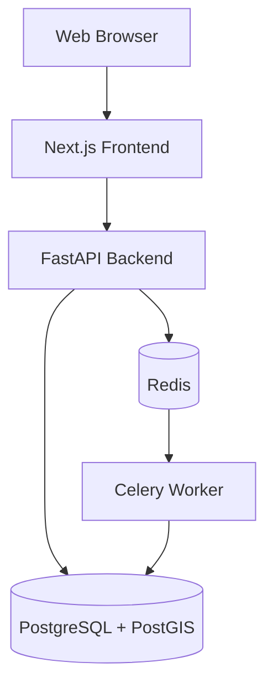

# Docker Setup

## 1. Introduction

This document explains how to configure and run TERRAMIND using Docker.

Docker provides a consistent environment for running application services without installing every dependency directly on the host machine.

TERRAMIND is designed to use Docker for:

- Running the FastAPI backend.
- Running the Next.js frontend.
- Running PostgreSQL with PostGIS.
- Running Redis.
- Running background workers.
- Managing application networks and persistent storage.
- Supporting local development and production deployment.

**Important:** This document describes the intended Docker architecture. Actual service names, ports, image versions, commands, and configuration must be verified against the repository's Dockerfiles and Compose files.

## 2. Prerequisites

Install the following tools:

- Docker Desktop
- Docker Engine
- Docker Compose plugin
- Git

Verify Docker:

```bash
docker --version
```

Verify Docker Compose:

```bash
docker compose version
```

Check whether the Docker engine is running:

```bash
docker info
```

If Docker Desktop is not running, start it before executing Compose commands.

## 3. Docker Project Structure

The expected Docker-related structure is:

```text
aleph-next/
├── backend/
│   ├── Dockerfile
│   └── .dockerignore
├── frontend/
│   ├── Dockerfile
│   └── .dockerignore
├── infrastructure/
│   └── docker/
├── docker-compose.yml
├── docker-compose.prod.yml
└── .dockerignore
```

### File responsibilities

| File | Purpose |
|---|---|
| `backend/Dockerfile` | Builds the backend container image |
| `frontend/Dockerfile` | Builds the frontend container image |
| `docker-compose.yml` | Defines local development services |
| `docker-compose.prod.yml` | Adds production-specific configuration |
| `.dockerignore` | Excludes unnecessary files from build contexts |
| `infrastructure/docker/` | Additional Docker configuration, if needed |

## 4. Expected Docker Services

The intended local environment may contain the following services:

| Service | Responsibility | Typical container port |
|---|---|---:|
| `backend` | FastAPI application | 8000 |
| `frontend` | Next.js application | 3000 |
| `postgres` | PostgreSQL and PostGIS | 5432 |
| `redis` | Cache and task broker | 6379 |
| `worker` | Background processing | No public port required |

Additional services can be introduced when the application requires them.

## 5. Docker Compose Architecture

The following diagram shows the intended local service relationships.



The browser accesses the frontend. The frontend communicates with the backend API. The backend uses PostgreSQL for persistent data and Redis for caching or task coordination. Background workers process queued tasks.

## 6. Docker Compose Configuration

The root `docker-compose.yml` defines the services used for local development.

Before changing this file, inspect the existing configuration.

A simplified reference configuration is shown below:

```yaml
services:
  postgres:
    image: postgis/postgis:16-3.4
    container_name: aleph-next-postgres
    environment:
      POSTGRES_DB: ${POSTGRES_DB}
      POSTGRES_USER: ${POSTGRES_USER}
      POSTGRES_PASSWORD: ${POSTGRES_PASSWORD}
    ports:
      - "5432:5432"
    volumes:
      - postgres_data:/var/lib/postgresql/data
    healthcheck:
      test:
        - CMD-SHELL
        - pg_isready -U ${POSTGRES_USER} -d ${POSTGRES_DB}
      interval: 10s
      timeout: 5s
      retries: 5

  redis:
    image: redis:7-alpine
    container_name: aleph-next-redis
    ports:
      - "6379:6379"
    volumes:
      - redis_data:/data
    healthcheck:
      test: ["CMD", "redis-cli", "ping"]
      interval: 10s
      timeout: 5s
      retries: 5

  backend:
    build:
      context: ./backend
      dockerfile: Dockerfile
    container_name: aleph-next-backend
    env_file:
      - .env
    ports:
      - "8000:8000"
    depends_on:
      postgres:
        condition: service_healthy
      redis:
        condition: service_healthy

  frontend:
    build:
      context: ./frontend
      dockerfile: Dockerfile
    container_name: aleph-next-frontend
    ports:
      - "3000:3000"
    depends_on:
      - backend

volumes:
  postgres_data:
  redis_data:
```

This is an illustrative configuration, not a replacement for the actual project configuration.

Before using it, verify:

- Environment variable names.
- Database connection configuration.
- Backend startup command.
- Frontend build and startup commands.
- Docker image compatibility.
- Health checks.
- Volume paths.
- Whether development bind mounts are required.

Do not overwrite an existing Compose file without reviewing its current services and settings.

## 7. Backend Dockerfile

Location:

`backend/Dockerfile`

The backend Dockerfile should:

1. Select a compatible Python base image.
2. Set the application working directory.
3. Install required system dependencies.
4. Install Python dependencies.
5. Copy the backend application.
6. Expose the API port.
7. Start the FastAPI application.

Example structure:

```dockerfile
FROM python:3.12-slim

WORKDIR /app

ENV PYTHONDONTWRITEBYTECODE=1
ENV PYTHONUNBUFFERED=1

COPY pyproject.toml ./

# Install dependencies according to the project's
# actual dependency-management configuration.

COPY . .

EXPOSE 8000

CMD ["uvicorn", "app.main:app", "--host", "0.0.0.0", "--port", "8000"]
```

The dependency installation step and application entry point must match the actual backend project.

Geospatial dependencies such as GDAL may require additional operating-system packages.

## 8. Frontend Dockerfile

Location:

`frontend/Dockerfile`

The frontend Dockerfile should:

1. Select a compatible Node.js image.
2. Set the working directory.
3. Install frontend dependencies.
4. Copy the source code.
5. Build the Next.js application.
6. Start the production server.

Example structure:

```dockerfile
FROM node:22-alpine

WORKDIR /app

COPY package*.json ./

RUN npm ci

COPY . .

RUN npm run build

EXPOSE 3000

CMD ["npm", "run", "start"]
```

This is a basic reference Dockerfile. Production deployments should consider multi-stage builds, non-root users, image size, and runtime environment configuration.

The Node.js version must match the frontend's compatibility requirements.

## 9. Docker Networks

Docker Compose creates a network for services in the same project by default.

Services can communicate using their Compose service names.

For example:

```text
backend -> postgres:5432
backend -> redis:6379
```

When the backend runs inside Docker, do not use `localhost` to connect to another container.

Inside the backend container, `localhost` refers to the backend container itself.

Use the appropriate Compose service hostname instead.

## 10. Docker Volumes

Volumes provide persistent storage for services.

Expected volumes may include:

| Volume | Purpose |
|---|---|
| `postgres_data` | Persistent PostgreSQL database files |
| `redis_data` | Redis persistence, if enabled |
| Application storage volume | Generated files or datasets, if configured |

Example:

```yaml
volumes:
  postgres_data:
  redis_data:
```

Database volumes must be preserved when recreating application containers.

**Warning:** The following command removes volumes and can permanently delete local database data:

```bash
docker compose down -v
```

Do not use it unless you intentionally want to remove the associated persistent data.

## 11. Ports

Typical local development ports:

| Service | Host port | Container port |
|---|---:|---:|
| Frontend | 3000 | 3000 |
| Backend | 8000 | 8000 |
| PostgreSQL | 5432 | 5432 |
| Redis | 6379 | 6379 |

A port mapping uses this format:

```yaml
ports:
  - "HOST_PORT:CONTAINER_PORT"
```

For example:

```yaml
ports:
  - "8000:8000"
```

If a host port is already in use, change the host-side port while keeping the container-side port consistent with the application.

Do not expose database and Redis ports publicly in production unless there is a specific, secured operational requirement.

## 12. Starting Docker Services

Navigate to the repository root:

```bash
cd /d/Github/aleph-next
```

Build and start the services:

```bash
docker compose up --build -d
```

Check service status:

```bash
docker compose ps
```

View logs:

```bash
docker compose logs
```

Follow all service logs:

```bash
docker compose logs -f
```

Follow backend logs:

```bash
docker compose logs -f backend
```

Follow frontend logs:

```bash
docker compose logs -f frontend
```

The service names must match the actual Compose configuration.

## 13. Stopping Docker Services

Stop the services:

```bash
docker compose stop
```

Stop and remove containers and the default network:

```bash
docker compose down
```

This does not normally remove named persistent volumes.

Start the services again:

```bash
docker compose up -d
```

## 14. Rebuilding Services

Rebuild all services:

```bash
docker compose build
```

Rebuild and restart:

```bash
docker compose up --build -d
```

Rebuild a specific service:

```bash
docker compose build backend
```

Restart a specific service:

```bash
docker compose restart backend
```

## 15. Running Commands Inside Containers

Open a shell in the backend container:

```bash
docker compose exec backend sh
```

Open a shell in the frontend container:

```bash
docker compose exec frontend sh
```

Connect to PostgreSQL:

```bash
docker compose exec postgres psql -U aleph_user -d aleph_next
```

Check Redis:

```bash
docker compose exec redis redis-cli ping
```

The database username, database name, and service names must match the actual configuration.

## 16. Database Migrations

Run Alembic migrations inside the backend container when the backend image includes Alembic and the database is available:

```bash
docker compose exec backend alembic upgrade head
```

Check the current migration:

```bash
docker compose exec backend alembic current
```

Run migrations according to the project's release and migration procedure. Avoid running multiple competing migration processes.

## 17. Development and Production Configuration

Development and production have different requirements.

| Area | Development | Production |
|---|---|---|
| Debugging | Enabled when needed | Disabled |
| Source code | May use bind mounts | Built into images |
| Database | Local or Docker | Managed or secured database |
| Secrets | Local environment files | Secret manager or secure injection |
| Logging | Developer-friendly | Centralized and structured |
| HTTPS | Optional locally | Required |
| Restart policy | Development convenience | Operationally configured |
| Image builds | Frequent rebuilds | Versioned, tested images |

The production Compose file should contain only the necessary production-specific configuration.

Do not assume that a production configuration is secure merely because it uses Docker.

## 18. Docker Troubleshooting

### 18.1 Docker engine is unavailable

Run:

```bash
docker info
```

If the command fails, check Docker Desktop and wait until its engine is running.

### 18.2 Port is already allocated

Inspect the running containers:

```bash
docker ps
```

Check the host port usage in Windows PowerShell:

```powershell
netstat -ano | findstr :8000
```

Replace `8000` with the affected port.

### 18.3 Container exits immediately

Inspect logs:

```bash
docker compose logs backend
```

Check:

- Application startup command.
- Missing dependencies.
- Environment variables.
- Database availability.
- Application exceptions.

### 18.4 Database connection fails

Check PostgreSQL:

```bash
docker compose ps postgres
docker compose logs postgres
```

Verify that the backend uses the correct Compose service hostname and database credentials.

### 18.5 Frontend cannot reach the backend

Check the configured API URL.

A browser request normally uses a host-accessible URL such as:

```text
http://localhost:8000
```

A server-side request from the frontend container may instead need the backend service hostname.

Choose the URL according to where the request is executed.

### 18.6 Rebuild does not apply changes

Try:

```bash
docker compose up --build -d
```

If necessary, rebuild a specific service:

```bash
docker compose build --no-cache backend
docker compose up -d backend
```

Use `--no-cache` only when a normal build does not resolve the issue.

## 19. Docker Best Practices

1. Use pinned and supported base image versions.
2. Keep Docker images as small as practical.
3. Use `.dockerignore` files.
4. Avoid copying secrets into images.
5. Use persistent volumes for database data.
6. Configure service health checks.
7. Run containers with non-root users where practical.
8. Keep production services private.
9. Review image vulnerabilities.
10. Keep development and production configuration separate.
11. Monitor container resource consumption.
12. Back up persistent data independently of container lifecycle.

## 20. Implementation Status

This document describes the intended Docker setup for TERRAMIND.

Before using the examples:

1. Inspect the existing Dockerfiles.
2. Inspect `docker-compose.yml`.
3. Inspect `docker-compose.prod.yml`.
4. Confirm the actual service names and ports.
5. Confirm environment variable names.
6. Verify persistent volume configuration.
7. Test service startup and connectivity.
8. Update this document to match the verified implementation.

The actual Docker configuration files are the source of truth.

---

**Document:** Docker Setup  
**Project:** TERRAMIND  
**Status:** Docker reference guide / requires repository verification