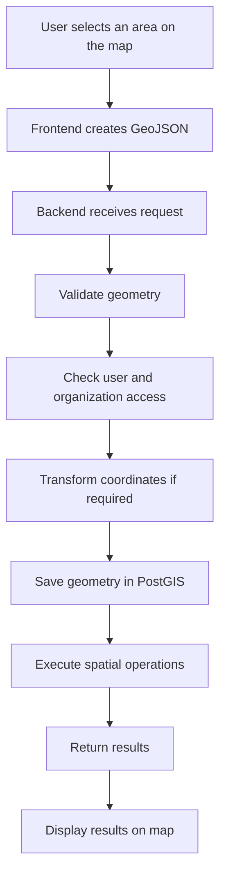

# Geospatial Processing

## 1. Introduction

Geospatial processing is a core component of TERRAMIND. It allows users to work with geographic locations, selected map areas, satellite imagery, terrain information, and spatial datasets.

The platform is designed to support:

- Geographic area selection.
- Geometry validation.
- Coordinate transformation.
- Spatial database queries.
- Raster and vector data processing.
- Satellite imagery analysis.
- Geospatial index calculations.
- Change detection.
- Geographic visualization.

This document describes the target geospatial processing architecture. Individual capabilities must be verified against the actual implementation.

## 2. Geospatial Technology Stack

| Technology | Purpose |
|---|---|
| PostgreSQL | Store application data |
| PostGIS | Store and query spatial data |
| GeoAlchemy2 | Integrate spatial database types with SQLAlchemy |
| Shapely | Geometry operations and validation |
| GeoPandas | Vector data processing |
| Rasterio | Raster data reading and processing |
| GDAL | Geospatial data conversion and processing |
| NumPy | Numerical calculations |
| MapLibre GL JS | Display geographic data |
| FastAPI | Provide geospatial API endpoints |

## 3. Geographic Data Types

The platform may work with the following geographic data types.

### 3.1 Point

A point represents a single geographic location.

Example:

```json
{
  "type": "Point",
  "coordinates": [79.8612, 6.9271]
}
```

### 3.2 LineString

A LineString represents a line connecting multiple geographic locations.

```json
{
  "type": "LineString",
  "coordinates": [
    [79.8612, 6.9271],
    [79.8700, 6.9300]
  ]
}
```

### 3.3 Polygon

A Polygon represents a geographic area.

```json
{
  "type": "Polygon",
  "coordinates": [
    [
      [79.8500, 6.9200],
      [79.8700, 6.9200],
      [79.8700, 6.9400],
      [79.8500, 6.9400],
      [79.8500, 6.9200]
    ]
  ]
}
```

The first and last coordinates of a polygon ring must match to close the ring.

### 3.4 MultiPolygon

A MultiPolygon represents multiple polygon geometries.

It is useful when an area consists of separate geographic regions.

## 4. Coordinate Reference Systems

A Coordinate Reference System (CRS) defines how geographic coordinates represent positions on Earth.

TERRAMIND should support commonly used coordinate reference systems.

### 4.1 EPSG:4326

EPSG:4326 uses geographic coordinates based on latitude and longitude.

It is commonly used with GeoJSON and web mapping applications.

Example:

```text
Longitude: 79.8612
Latitude:   6.9271
```

GeoJSON coordinates use this order:

```text
[longitude, latitude]
```

### 4.2 EPSG:3857

EPSG:3857 is Web Mercator.

It is commonly used for web map display and tile services.

### 4.3 Coordinate Transformation

Coordinate transformations convert geographic data from one CRS to another.

Example using Python:

```python
from pyproj import Transformer

transformer = Transformer.from_crs(
    "EPSG:4326",
    "EPSG:3857",
    always_xy=True
)

x, y = transformer.transform(
    79.8612,
    6.9271
)

print(x, y)
```

Use an appropriate projected CRS for accurate distance and area calculations. EPSG:3857 is generally not suitable for precise measurement.

## 5. Geometry Validation

Before storing or processing geographic data, the backend should validate the submitted geometry.

Validation should include:

- Valid GeoJSON structure.
- Supported geometry type.
- Valid coordinate values.
- Correct coordinate ordering.
- Closed polygon rings.
- Non-empty geometry.
- Valid polygon topology.
- Maximum permitted geometry size.
- Maximum permitted number of vertices.
- Expected coordinate reference system.

Example using Shapely:

```python
from shapely.geometry import shape

def validate_geometry(geojson: dict):
    geometry = shape(geojson)

    if geometry.is_empty:
        raise ValueError("Geometry cannot be empty")

    if not geometry.is_valid:
        raise ValueError("Invalid geometry")

    return geometry
```

Geometry validation should also enforce application-specific restrictions.

For example, users should not be allowed to submit extremely large polygons that could overload spatial queries.

## 6. Spatial Database Architecture

PostgreSQL with PostGIS is the target spatial database.

Spatial data can be stored using PostGIS geometry columns.

Example:

```sql
CREATE TABLE areas (
    id UUID PRIMARY KEY,
    name VARCHAR(255) NOT NULL,
    geometry GEOMETRY(MULTIPOLYGON, 4326),
    created_at TIMESTAMP DEFAULT CURRENT_TIMESTAMP
);
```

This is an illustrative schema. Use Alembic migrations and the actual SQLAlchemy models when implementing the database.

### 6.1 Spatial Indexing

Spatial indexes improve the performance of geographic queries.

Example:

```sql
CREATE INDEX idx_areas_geometry
ON areas
USING GIST (geometry);
```

A spatial index should be created for frequently queried geometry columns.

### 6.2 Spatial Queries

Find areas that intersect a given geometry:

```sql
SELECT *
FROM areas
WHERE ST_Intersects(
    geometry,
    ST_GeomFromText(
        'POINT(79.8612 6.9271)',
        4326
    )
);
```

Find areas containing a geographic point:

```sql
SELECT *
FROM areas
WHERE ST_Contains(
    geometry,
    ST_SetSRID(
        ST_Point(79.8612, 6.9271),
        4326
    )
);
```

Calculate an approximate distance in meters using geography:

```sql
SELECT ST_Distance(
    geometry::geography,
    ST_SetSRID(
        ST_Point(79.8612, 6.9271),
        4326
    )::geography
)
FROM areas;
```

## 7. Backend Geospatial Architecture

Geospatial processing should be separated from API endpoint logic.

Target structure:

```text
backend/app/
├── api/
│   └── v1/
│       └── endpoints/
│           ├── areas.py
│           ├── raster.py
│           └── analysis.py
│
├── geospatial/
│   ├── geometry.py
│   ├── coordinates.py
│   ├── spatial_queries.py
│   ├── raster_processor.py
│   └── raster_utils.py
│
├── services/
│   ├── area_service.py
│   ├── raster_service.py
│   └── analysis_service.py
│
└── schemas/
    ├── area.py
    ├── raster.py
    └── analysis.py
```

### Responsibilities

**API endpoints**

- Receive HTTP requests.
- Validate request schemas.
- Authenticate users.
- Apply authorization checks.
- Return API responses.

**Services**

- Coordinate geospatial workflows.
- Apply business rules.
- Communicate with repositories and processing modules.

**Geospatial modules**

- Validate geometries.
- Transform coordinates.
- Perform spatial calculations.
- Process vector and raster datasets.

**Repositories**

- Access PostgreSQL and PostGIS.
- Execute spatial database queries.
- Persist geographic metadata.

## 8. Geospatial Processing Workflow

The target workflow is:



## 9. Frontend Map Integration

The frontend uses MapLibre GL JS as the target mapping library.

The map interface should support:

- Displaying geographic maps.
- Selecting geographic locations.
- Drawing polygons.
- Editing selected areas.
- Displaying area boundaries.
- Showing satellite imagery layers.
- Displaying raster overlays.
- Viewing analysis results.

The frontend should send geometry to the backend using GeoJSON.

Example:

```typescript
interface GeographicArea {
  type: "Polygon" | "MultiPolygon";
  coordinates: number[][][] | number[][][][];
}

interface CreateAreaRequest {
  name: string;
  geometry: GeographicArea;
}
```

The actual frontend types should be aligned with the backend Pydantic schemas.

## 10. Vector Data Processing

Vector data represents geographic objects using points, lines, and polygons.

Potential supported formats include:

- GeoJSON.
- Shapefile.
- GeoPackage.
- GeoParquet.

Example using GeoPandas:

```python
import geopandas as gpd

gdf = gpd.read_file("data/areas.geojson")

print(gdf.head())

print(gdf.crs)
```

Reproject vector data:

```python
gdf = gdf.to_crs("EPSG:4326")
```

Calculate area using a suitable projected CRS:

```python
projected = gdf.to_crs("EPSG:32644")

projected["area_m2"] = projected.geometry.area
```

The selected projected CRS must be appropriate for the dataset's geographic location.

## 11. Raster Data Processing

Raster data represents geographic information as a grid of pixels.

Examples include:

- Satellite imagery.
- Elevation data.
- Vegetation index imagery.
- Land-cover classification.
- Temperature datasets.

Rasterio is the target Python library for raster operations.

Example:

```python
import rasterio

with rasterio.open("data/sample.tif") as dataset:
    print("Width:", dataset.width)
    print("Height:", dataset.height)
    print("CRS:", dataset.crs)
    print("Bounds:", dataset.bounds)
```

Raster processing is described in detail in `raster-processing.md`.

## 12. Area-Based Analysis

Users should be able to select an area and request analysis for that geographic region.

Example workflow:

1. User selects a polygon.
2. Backend validates the geometry.
3. Backend checks the user's organization permissions.
4. The system identifies intersecting datasets.
5. Relevant raster data is retrieved.
6. Raster data is clipped or masked to the selected area.
7. Analysis is performed.
8. Results and metadata are stored.
9. Results are returned to the frontend.

Potential analysis types include:

- NDVI.
- EVI.
- SAVI.
- NDWI.
- NBR.
- Land-cover classification.
- Change detection.
- Environmental risk analysis.

## 13. Asynchronous Geospatial Processing

Large geospatial operations should not block normal API requests.

The target architecture uses background workers.

Example:

```text
Frontend
   |
   v
FastAPI
   |
   v
Create Analysis Job
   |
   v
Redis / Celery
   |
   v
Geospatial Worker
   |
   v
Process Dataset
   |
   v
Save Results
   |
   v
Update Job Status
   |
   v
Frontend Retrieves Results
```

A job should expose clear states:

- PENDING
- RUNNING
- COMPLETED
- FAILED
- CANCELLED

The API should provide a job identifier so the frontend can retrieve processing status.

## 14. Performance Optimization

Geospatial processing can consume significant CPU, memory, and storage resources.

Recommended practices:

- Use PostGIS spatial indexes.
- Avoid loading complete datasets into memory unnecessarily.
- Process large rasters in windows or blocks.
- Use appropriate raster resolutions.
- Reproject data only when required.
- Cache reusable analysis results.
- Run expensive calculations in background workers.
- Apply geometry size and request limits.
- Monitor worker memory and processing time.
- Use object storage for large datasets.

## 15. Security Considerations

Geospatial APIs must follow the platform's security rules.

Important controls:

- Require authentication.
- Validate organization membership.
- Check project and area permissions.
- Restrict access to private datasets.
- Validate uploaded geographic files.
- Limit upload sizes.
- Prevent unauthorized dataset downloads.
- Record important analysis and export actions.
- Avoid exposing internal storage paths.

Spatial queries must respect tenant isolation.

## 16. Testing

Geospatial processing should include unit, integration, and performance tests.

### Unit Tests

Test:

- Geometry validation.
- Coordinate transformations.
- Polygon handling.
- Spatial calculations.
- Invalid geometry rejection.

### Integration Tests

Test:

- PostGIS geometry storage.
- Spatial indexes.
- Spatial query results.
- Area creation APIs.
- Organization-level access restrictions.

### Performance Tests

Test:

- Large polygons.
- Complex geometries.
- Large spatial queries.
- Raster processing workloads.
- Concurrent analysis jobs.

Example test:

```python
from shapely.geometry import Polygon

def test_polygon_is_valid():
    polygon = Polygon([
        (79.85, 6.92),
        (79.87, 6.92),
        (79.87, 6.94),
        (79.85, 6.94),
        (79.85, 6.92)
    ])

    assert polygon.is_valid
```

## 17. Implementation Verification

Before considering this module complete, verify:

- [ ] PostGIS is installed and enabled.
- [ ] SQLAlchemy spatial models are implemented.
- [ ] Geometry validation is implemented.
- [ ] Coordinate transformations are tested.
- [ ] Spatial indexes exist.
- [ ] Spatial queries return correct results.
- [ ] Area APIs work.
- [ ] Frontend geometry selection works.
- [ ] Organization access restrictions are enforced.
- [ ] Raster processing integrates with the spatial workflow.
- [ ] Background jobs work for expensive operations.
- [ ] Geospatial tests pass.

## 18. Important Notes

This document describes the target geospatial architecture of TERRAMIND.

It does not confirm that every listed library, module, endpoint, or processing capability currently exists in the repository.

Before implementation, inspect the actual backend, frontend, database migrations, Docker configuration, and installed dependencies. Update this document when implementation details are verified.