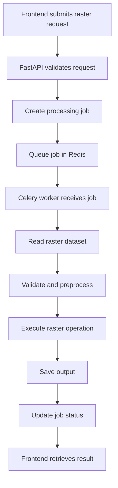

# Raster Processing

## 1. Introduction

Raster processing is a core geospatial capability of TERRAMIND.

Raster data represents geographic information as a grid of pixels. Each pixel contains one or more values representing information about a geographic location.

The platform is designed to process raster datasets from satellite imagery, elevation models, environmental observations, and other geospatial sources.

Potential applications include:

- Satellite imagery processing.
- Vegetation index calculations.
- Elevation and terrain analysis.
- Water-body monitoring.
- Land-cover classification.
- Environmental monitoring.
- Geographic change detection.
- Raster visualization.

This document describes the target raster processing architecture. Actual implementation must be verified against the repository.

## 2. Raster Data Concepts

### 2.1 What Is Raster Data?

A raster dataset is a grid of cells or pixels.

Each pixel stores a value representing information about a geographic location.

For example:

- Satellite imagery pixels contain reflectance measurements.
- Elevation raster pixels contain height values.
- NDVI raster pixels contain vegetation index values.
- Temperature raster pixels contain temperature measurements.

### 2.2 Raster Dimensions

A raster dataset commonly contains:

| Property | Description |
|---|---|
| Width | Number of columns |
| Height | Number of rows |
| Bands | Number of raster layers |
| CRS | Coordinate Reference System |
| Transform | Relationship between pixel and geographic coordinates |
| Bounds | Geographic extent |
| NoData | Value representing missing or invalid data |
| Data type | Numeric type used to store pixel values |
| Resolution | Geographic size represented by each pixel |

### 2.3 Single-Band Raster

A single-band raster contains one layer of pixel values.

Examples:

- Elevation.
- NDVI.
- Temperature.
- Soil moisture.

### 2.4 Multi-Band Raster

A multi-band raster contains several layers.

Satellite imagery commonly uses multiple spectral bands.

For example, Sentinel-2 provides blue, green, red, near-infrared, and shortwave-infrared bands.

These bands can be combined for visualization and scientific analysis.

## 3. Raster Processing Technology Stack

The target Python processing stack includes:

| Technology | Purpose |
|---|---|
| Rasterio | Read and write raster datasets |
| GDAL | Geospatial raster processing |
| NumPy | Numerical calculations |
| PyProj | Coordinate transformations |
| Shapely | Geometry operations |
| GeoPandas | Vector data processing |
| rioxarray | Raster processing with xarray integration |
| Dask | Larger-than-memory and parallel processing workflows |
| PostGIS | Spatial metadata and database operations |

Not every dependency needs to be installed at the beginning. Select libraries based on the actual processing requirements.

## 4. Supported Raster Formats

The platform may support the following formats.

| Format | Description |
|---|---|
| GeoTIFF | Common geospatial raster format |
| Cloud Optimized GeoTIFF | Optimized GeoTIFF for efficient remote access |
| COG | Common abbreviation for Cloud Optimized GeoTIFF |
| NetCDF | Scientific multidimensional data format |
| JPEG2000 | Raster format used in some satellite products |
| VRT | GDAL virtual raster |
| Zarr | Chunked multidimensional array storage |

GeoTIFF and Cloud Optimized GeoTIFF should be prioritized for the initial raster workflows.

## 5. Raster Processing Architecture

The target architecture separates API operations from raster processing.

```text
backend/app/
├── geospatial/
│   ├── raster_processor.py
│   ├── raster_utils.py
│   ├── coordinates.py
│   ├── geometry.py
│   ├── band_mapping.py
│   ├── reflectance.py
│   └── cloud_mask.py
│
├── services/
│   └── raster_service.py
│
├── workers/
│   └── raster_tasks.py
│
├── storage/
│   ├── base.py
│   ├── local_storage.py
│   ├── s3_storage.py
│   └── storage_factory.py
│
└── api/
    └── v1/
        └── endpoints/
            └── raster.py
```

### Responsibilities

**API endpoint**

- Receive raster processing requests.
- Validate request parameters.
- Authenticate users.
- Check access permissions.
- Return processing job information.

**Raster service**

- Coordinate processing operations.
- Retrieve source datasets.
- Apply processing configurations.
- Register output metadata.

**Raster processor**

- Read raster data.
- Inspect metadata.
- Reproject raster datasets.
- Clip raster datasets.
- Apply masks.
- Calculate raster statistics.

**Background worker**

- Execute expensive processing tasks.
- Update processing status.
- Handle failures and retries.

**Storage service**

- Save source and processed datasets.
- Manage object storage paths.
- Retrieve generated outputs.

## 6. Reading Raster Data

Rasterio is the primary target library for reading raster files.

Example:

```python
import rasterio

raster_path = "data/sample.tif"

with rasterio.open(raster_path) as dataset:
    print("Width:", dataset.width)
    print("Height:", dataset.height)
    print("Bands:", dataset.count)
    print("CRS:", dataset.crs)
    print("Bounds:", dataset.bounds)
    print("Data type:", dataset.dtypes)
    print("NoData:", dataset.nodata)
```

Read a specific band:

```python
import rasterio

with rasterio.open("data/sample.tif") as dataset:
    band = dataset.read(1)

    print("Shape:", band.shape)
    print("Minimum:", band.min())
    print("Maximum:", band.max())
```

For production processing, handle NoData values and invalid pixels before calculating statistics.

## 7. Raster Band Selection

Satellite imagery often contains several spectral bands.

The platform should maintain band mappings for each supported satellite collection.

Example Sentinel-2 mapping:

| Band | Wavelength region | Common use |
|---|---|---|
| B02 | Blue | Water and atmospheric analysis |
| B03 | Green | Vegetation and water analysis |
| B04 | Red | Vegetation analysis |
| B05 | Red Edge | Vegetation condition |
| B06 | Red Edge | Vegetation condition |
| B07 | Red Edge | Vegetation condition |
| B08 | Near Infrared | Vegetation analysis |
| B8A | Narrow Near Infrared | Vegetation analysis |
| B11 | Shortwave Infrared | Moisture and burn analysis |
| B12 | Shortwave Infrared | Burn and moisture analysis |

The actual band mapping must match the satellite product and processing level.

## 8. Raster Data Validation

Before processing, the system should validate raster metadata and file contents.

Validation should include:

- File existence and accessibility.
- Supported raster format.
- Valid raster dimensions.
- Valid CRS.
- Valid geospatial bounds.
- Expected band count.
- Expected data type.
- NoData configuration.
- Pixel resolution.
- File integrity.
- Maximum permitted file size.

Example:

```python
import rasterio


def validate_raster(path: str):
    with rasterio.open(path) as dataset:
        if dataset.width <= 0 or dataset.height <= 0:
            raise ValueError("Invalid raster dimensions")

        if dataset.count < 1:
            raise ValueError("Raster has no bands")

        if dataset.crs is None:
            raise ValueError("Raster CRS is missing")

        return {
            "width": dataset.width,
            "height": dataset.height,
            "bands": dataset.count,
            "crs": str(dataset.crs),
            "bounds": tuple(dataset.bounds),
            "nodata": dataset.nodata
        }
```

File validation should also account for malformed files and resource-exhaustion risks.

## 9. Raster Clipping

Raster clipping extracts pixels within a selected geographic area.

This is important because users usually need analysis for a selected region rather than an entire satellite scene.

Example:

```python
import rasterio

from rasterio.mask import mask
from shapely.geometry import box, mapping


with rasterio.open("data/sample.tif") as dataset:

    area = box(
        79.85,
        6.92,
        79.87,
        6.94
    )

    clipped, transform = mask(
        dataset,
        [mapping(area)],
        crop=True
    )

    print("Clipped shape:", clipped.shape)
```

Important considerations:

- Input geometry must use the raster's CRS.
- Reproject the geometry when necessary.
- Handle areas that do not intersect the raster.
- Preserve the output transform.
- Preserve relevant metadata.
- Apply a valid NoData strategy.

The example uses a rectangular polygon for demonstration. Production workflows should support validated user-selected geometries.

## 10. Raster Reprojection

Raster reprojection changes a raster dataset from one coordinate reference system to another.

Example:

```python
import rasterio

from rasterio.warp import (
    calculate_default_transform,
    reproject,
    Resampling
)


source_path = "data/source.tif"
destination_path = "data/reprojected.tif"

with rasterio.open(source_path) as source:

    destination_crs = "EPSG:4326"

    transform, width, height = calculate_default_transform(
        source.crs,
        destination_crs,
        source.width,
        source.height,
        *source.bounds
    )

    profile = source.profile.copy()

    profile.update({
        "crs": destination_crs,
        "transform": transform,
        "width": width,
        "height": height
    })

    with rasterio.open(
        destination_path,
        "w",
        **profile
    ) as destination:

        for band in range(1, source.count + 1):

            reproject(
                source=rasterio.band(source, band),
                destination=rasterio.band(destination, band),
                src_transform=source.transform,
                src_crs=source.crs,
                dst_transform=transform,
                dst_crs=destination_crs,
                resampling=Resampling.nearest
            )
```

Choose resampling methods based on the data:

| Method | Common use |
|---|---|
| Nearest | Categorical data and class labels |
| Bilinear | Continuous measurements |
| Cubic | Continuous imagery where smoother interpolation is appropriate |
| Average | Aggregating continuous data to a coarser resolution |

The correct method depends on the scientific meaning of the raster values.

## 11. Raster Resampling

Resampling changes raster resolution or aligns data to another grid.

Potential applications:

- Combining multiple satellite bands.
- Matching raster grids.
- Creating lower-resolution outputs.
- Preparing data for analysis.

Categorical raster data should generally use nearest-neighbor resampling.

Continuous raster data may use bilinear, cubic, or average resampling depending on the operation.

Resampling does not create new real-world spatial information.

## 12. NoData and Mask Handling

NoData represents missing or invalid raster values.

The platform must distinguish between:

- Valid zero values.
- Missing pixels.
- Cloud-covered pixels.
- Cloud-shadow pixels.
- Invalid measurements.
- Pixels outside the selected geometry.

Example:

```python
import numpy as np
import rasterio

with rasterio.open("data/sample.tif") as dataset:

    values = dataset.read(1).astype("float32")

    nodata = dataset.nodata

    if nodata is not None:
        values[values == nodata] = np.nan

    valid_pixels = values[np.isfinite(values)]

    if valid_pixels.size == 0:
        raise ValueError("Raster contains no valid pixels")

    print("Minimum:", np.min(valid_pixels))
    print("Maximum:", np.max(valid_pixels))
    print("Mean:", np.mean(valid_pixels))
```

For satellite imagery, use the product's quality bands or classification masks when available.

## 13. Reflectance Scaling

Satellite data may contain stored integer values that need scaling before scientific calculations.

For example, some Sentinel-2 Level-2A products use a reflectance scale factor of 10,000, subject to product-specific metadata and processing conventions.

A simplified conversion may be:

```python
import numpy as np

digital_numbers = np.array([2500, 5000, 7500])

reflectance = digital_numbers / 10000.0

print(reflectance)
```

Do not assume that every satellite collection uses the same scaling factor.

Check the product documentation and metadata before converting values.

Also account for offsets where specified by the product.

## 14. Cloud and Cloud-Shadow Masking

Clouds and cloud shadows can affect optical satellite analysis.

The platform should use suitable quality information to identify unreliable pixels.

Potential Sentinel-2 masking sources include:

- Scene Classification Layer.
- Cloud probability products.
- Quality masks provided by the collection.

The processing workflow should:

1. Read the required quality information.
2. Identify cloud pixels.
3. Identify cloud-shadow pixels.
4. Identify invalid pixels.
5. Build a valid-data mask.
6. Apply the mask to the imagery.
7. Record the masking method in the processing metadata.

Cloud masking must be adapted to the selected satellite collection.

## 15. Raster Statistics

Raster statistics summarize pixel values.

Common statistics include:

- Minimum.
- Maximum.
- Mean.
- Median.
- Standard deviation.
- Valid pixel count.
- NoData pixel count.

Example:

```python
import numpy as np
import rasterio

with rasterio.open("data/sample.tif") as dataset:

    values = dataset.read(1).astype("float32")

    if dataset.nodata is not None:
        values[values == dataset.nodata] = np.nan

    valid = values[np.isfinite(values)]

    statistics = {
        "minimum": float(np.min(valid)),
        "maximum": float(np.max(valid)),
        "mean": float(np.mean(valid)),
        "median": float(np.median(valid)),
        "standard_deviation": float(np.std(valid)),
        "valid_pixels": int(valid.size)
    }

    print(statistics)
```

Statistics should be calculated after applying the appropriate validity masks.

## 16. Raster Visualization

Processed raster datasets should be displayed on the frontend using a suitable map visualization approach.

Potential visualization methods include:

- Cloud Optimized GeoTIFF tile access.
- Raster tiles.
- XYZ tile services.
- Web Map Service.
- Web Coverage Service.

MapLibre GL JS can display raster tile sources.

Example:

```typescript
map.addSource("satellite-layer", {
  type: "raster",
  tiles: [
    "https://example.com/tiles/{z}/{x}/{y}.png"
  ],
  tileSize: 256
});

map.addLayer({
  id: "satellite-layer",
  type: "raster",
  source: "satellite-layer"
});
```

This example requires a compatible raster tile service. A raw GeoTIFF URL cannot automatically be used as an XYZ raster tile source.

The application must control access to private raster data.

## 17. Asynchronous Raster Processing

Large raster operations should run as background jobs.

The target workflow:



Each processing job should maintain:

- Job identifier.
- Dataset identifier.
- Processing operation.
- Job status.
- Start time.
- Completion time.
- Error information.
- Output dataset identifier.

## 18. Storage Architecture

Raster datasets can be stored using local storage during development and Amazon S3 in production.

Suggested logical structure:

```text
storage/
├── datasets/
│   └── organization-id/
│       └── project-id/
│           └── source-data/
│
├── processed/
│   └── organization-id/
│       └── project-id/
│           └── raster-outputs/
│
├── temporary/
│   └── processing-jobs/
│
└── exports/
    └── organization-id/
        └── project-id/
```

This is a logical organization example, not a required physical directory structure.

Use unique object identifiers, authorization checks, and lifecycle policies.

## 19. Performance Optimization

Raster processing can require significant CPU, memory, and storage resources.

Recommended practices:

- Use window-based raster processing.
- Avoid loading large rasters entirely into memory.
- Use Cloud Optimized GeoTIFF where suitable.
- Use appropriate block sizes.
- Process only the required geographic region.
- Use Dask for workloads that benefit from chunked parallel processing.
- Cache reusable results.
- Limit concurrent processing jobs.
- Monitor worker memory and CPU usage.
- Store large outputs in object storage.
- Clean up temporary processing files.

## 20. API Design

Potential endpoints:

| Method | Endpoint | Purpose |
|---|---|---|
| GET | `/api/v1/raster/{dataset_id}` | Retrieve raster metadata |
| POST | `/api/v1/raster/validate` | Validate a raster |
| POST | `/api/v1/raster/clip` | Create a clipped raster |
| POST | `/api/v1/raster/reproject` | Reproject a raster |
| POST | `/api/v1/raster/statistics` | Calculate raster statistics |
| POST | `/api/v1/raster/jobs` | Create a raster processing job |
| GET | `/api/v1/raster/jobs/{job_id}` | Retrieve job status |

These are proposed endpoints. Verify actual routes before documenting them as implemented.

## 21. Error Handling

The system should handle:

| Error | Recommended handling |
|---|---|
| Missing raster | Return a clear not-found response |
| Unsupported format | Reject the file |
| Missing CRS | Require explicit CRS information or reject |
| Invalid dimensions | Reject the dataset |
| Invalid geometry | Reject the processing request |
| No intersection | Return a meaningful processing result |
| Insufficient storage | Fail safely and report the error |
| Processing timeout | Record failure and apply an appropriate retry policy |
| Corrupt raster | Reject the dataset and record the validation failure |

Avoid returning internal file paths or sensitive infrastructure details to users.

## 22. Security Considerations

- Authenticate raster API requests.
- Enforce organization and project permissions.
- Validate uploaded files.
- Limit file size and processing dimensions.
- Restrict filesystem access to approved storage locations.
- Prevent path traversal.
- Do not expose private object storage URLs.
- Apply processing timeouts.
- Limit concurrent jobs.
- Record important processing and export actions.

## 23. Testing

### Unit Tests

Test:

- Raster metadata reading.
- Band selection.
- NoData handling.
- Raster clipping.
- Reprojection.
- Resampling.
- Statistics calculations.
- Reflectance scaling.

### Integration Tests

Test:

- Raster storage.
- PostGIS metadata integration.
- Raster processing jobs.
- Object storage access.
- Processing status updates.
- API permissions.

### Performance Tests

Test:

- Large raster files.
- Multi-band imagery.
- Large geographic areas.
- Concurrent processing jobs.
- Memory consumption.
- Processing duration.

Use small, known test datasets for predictable tests.

## 24. Implementation Verification

Before considering raster processing complete, verify:

- [ ] Rasterio is configured.
- [ ] GDAL dependencies are available.
- [ ] Raster metadata reading works.
- [ ] Raster validation works.
- [ ] Band selection works.
- [ ] Geometry clipping works.
- [ ] Coordinate reprojection works.
- [ ] Resampling works.
- [ ] NoData handling works.
- [ ] Reflectance scaling is product-aware.
- [ ] Cloud masking works where applicable.
- [ ] Raster statistics are correct.
- [ ] Background processing works.
- [ ] Raster outputs are stored correctly.
- [ ] Frontend visualization works.
- [ ] Access restrictions are enforced.
- [ ] Automated tests pass.

## 25. Important Notes

This document describes the target raster processing architecture for TERRAMIND.

It does not confirm that all listed libraries, processing functions, APIs, workers, or storage integrations currently exist in the repository.

Verify the actual dependencies, processing modules, Docker environment, and database models before implementation.

Scientific processing results must be validated against known datasets and product-specific documentation before being used for environmental or operational decisions.